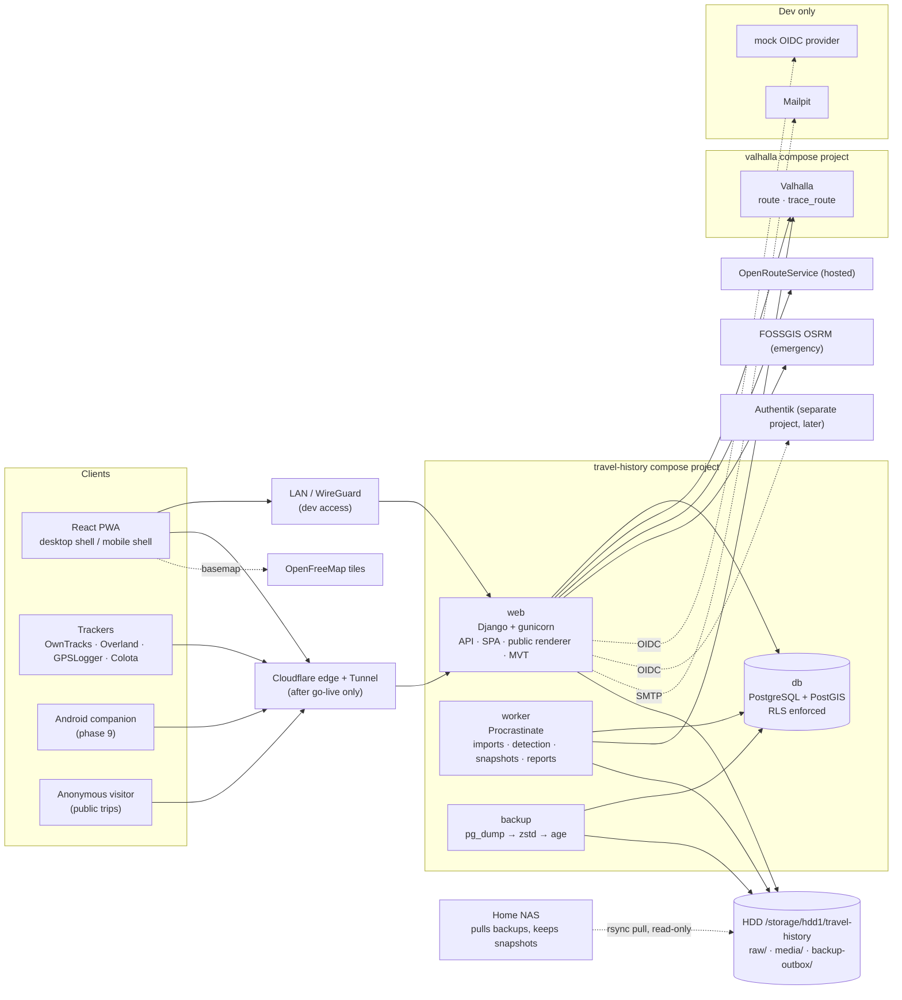

# Travel History — Plan

> Private, self-hosted catalog of a lifetime of travel for a family. Django + GeoDjango + PostGIS
> backend, React + TypeScript + MapLibre frontend, everything in Docker on a home server.
> This file is the single source of truth for design and progress. Keep it current
> (CLAUDE.md requires it).

**Status:** Phase 1 complete; phase 2 (Timeline and tracking) in progress — milestone 2.1 done. Last updated 2026-10-20.

Contents

1. [Prior-art evaluation](#1-prior-art-evaluation)
2. [Host and environment](#2-host-and-environment)
3. [Architecture](#3-architecture)
4. [Stack and libraries](#4-stack-and-libraries)
5. [Data model](#5-data-model)
6. [Permissions and visibility](#6-permissions-and-visibility)
7. [Auth, access requests, email, push](#7-auth-access-requests-email-push)
8. [Google Timeline import](#8-google-timeline-import)
9. [Live location tracking](#9-live-location-tracking)
10. [Home history](#10-home-history)
11. [Trip auto-detection](#11-trip-auto-detection)
12. [Flights](#12-flights)
13. [Routing, map matching, Valhalla](#13-routing-map-matching-valhalla)
14. [Map rendering](#14-map-rendering)
15. [Statistics and reverse geocoding](#15-statistics-and-reverse-geocoding)
16. [Photos and Immich](#16-photos-and-immich)
17. [API outline](#17-api-outline)
18. [UI layouts and keyboard shortcuts](#18-ui-layouts-and-keyboard-shortcuts)
19. [Android companion and desktop wrapper](#19-android-companion-and-desktop-wrapper)
20. [Threat model](#20-threat-model)
21. [Resource budget](#21-resource-budget)
22. [Backup, restore, export](#22-backup-restore-export)
23. [Phases, milestones, acceptance criteria](#23-phases-milestones-acceptance-criteria)
24. [Decisions log](#24-decisions-log)
25. [Open questions](#25-open-questions)
26. [External facts register](#26-external-facts-register)
27. [Licenses and attributions](#27-licenses-and-attributions)

---

## 1. Prior-art evaluation

Full notes: `docs/research/adventurelog-evaluation.md`, `docs/research/reference-projects.md`.

### 1.1 AdventureLog as a fork base → **not forked; building fresh**

AdventureLog (Django 5.2 + GeoDjango + PostGIS + SvelteKit, GPL-3.0-only in practice) was
cloned read-only and its models, views, permissions, settings and tests were read on 2026-10-19
(branches `main` v0.13.0, `development`, and the unreleased trip-rework branch).

| Criterion | Finding | Score (0–3) |
|---|---|---|
| Backend stack | Django 5.2, GeoDjango, PostGIS — matches | 3 |
| Frontend stack | SvelteKit 2 / Svelte 5 (~52k lines Svelte, 0 frontend tests) — would be discarded | 1 |
| Trips → ordered legs | `Collection` + generic `CollectionItineraryItem`; no legs | 1 |
| Frozen versioned routes | No LineString fields anywhere; transport has two points | 0 |
| Participants + per-leg overrides | Only `Collection.shared_with` (users) | 0 |
| Contribution permissions (author attribution, edit-own-only) | Shared users get full write; their items are re-owned by the collection owner | 0–1 |
| Row-level security | None (queryset filtering only) | 0 |
| Vehicles with ownership history, home periods, person ≠ user | None | 0 |
| Raw imports, append-only points, Timeline import, tracker ingestion | None (backup ZIP, GPX per activity, Strava) | 0 |
| Routing / drag-to-reshape | None | 0 |
| Offline reverse geocoding, county stats | Online Nominatim/Google; region/city counts; no counties | 1 |
| Flights with airport/airline data | Free-text codes on `Transportation` | 1 |
| Public pages with allowlist + privacy zones | `is_public` flags; allowlist only on the unreleased branch; no privacy zones | 1 |
| OIDC | django-allauth (old 0.63) `openid_connect`, Authentik guide | 3 |
| Immich | Proxied thumbnails, but API key stored in plaintext and returned to the client, `Cache-Control: public` on private images, no SSRF check | 2 |
| Security posture | DEBUG defaults on, `ALLOWED_HOSTS=['*']`, default admin/admin, uploads keep EXIF GPS; good protected-media pattern | — |
| Tests | 189 backend tests (4 for collection sharing), 0 frontend | — |
| Maintenance | Active: 8 releases in 2 years (v0.13.0 on 2026-08-12), 3.8k stars, 22–44 authors/yr; top author 45–56 % of recent commits, 89 % all-time → bus factor ≈ 1; a hosted commercial "cloud/billing" mode is being added | — |
| Upstream merge cost | ~2 months of upstream touched 318 files (+28k/−14k lines); the trip rework branch rewrites `Collection` again. Estimated < 10 % of future upstream commits would still apply after rewriting its core models and replacing its frontend | — |

**Decision rule applied:** fork only if it saves substantial work *and* its core models can
absorb ours without being rewritten. Neither holds: every core model (trips/legs/routes,
participation, RLS, vehicles, home periods, raw history) would be new or rewritten, the frontend
would be replaced, and upstream churn makes merging impractical. A fork would be "building fresh
with extra baggage" plus GPL-3.0 obligations on the Android APK. **Outcome: build fresh** (D-01).
Ideas worth reimplementing (not copying): exactly-one-parent constraints, an allowlist with
sections off by default, protected media served via the app with permission checks, prefixed
hashed API keys, a tiered-access Immich proxy (but private caching, encrypted key).

### 1.2 Reference projects

| Project | License (checked 2026-10-19) | Activity / bus factor | How we use it |
|---|---|---|---|
| gpx.studio | **MIT** (since 2024-06) | 663 commits/yr, one author ≈ 99 % | **Port** its anchor-point drag-to-reshape (`routing-controls.ts`, `simplify.ts`) to a React/TS controller **with attribution** (§13.4, §27). Its routing servers are its own (GraphHopper without a car profile, brouter.de) — not used. |
| AirTrail | **GPL-3.0** | v3.13.0 (2026-09), 33 authors/yr, top 60 % | **Reimplement** importers for MyFlightRadar24, Flighty, App in the Air, TripIt, JetLog, byAir from format specs written in our own words (`docs/research/reference-projects.md`). No code copied → no GPL obligation. |
| TREK | **AGPL-3.0** (MIT for one day in 2026-03) | very active, top 58 % | Ideas only: Atlas (visited countries/regions, planned vs visited, region marking from zoom 5, streaks), photo-first journal. |
| Reitti | **AGPL-3.0 since v5.0.0 (2026-07-05)**, MIT before | active, top ≈ 60–90 % | Ideas only: per-window speed classification with per-user thresholds, smoothing of implausible short runs, user overrides as timestamped modes. |
| Dawarich | **AGPL-3.0** | very active, top ≈ 94 % | Ideas only: Android vs iOS Timeline format detection by keys, streaming in batches, dwell-sweep visit detection, user edits as overlays that survive re-runs. |
| GeoPulse | **custom BSL 1.1** since 2025-11 (AGPL before), change date 2075 | active, top ≈ 98 % | Ideas only: rule cascade for trip classification (flight/boat/train/bike/car/walk by avg/peak speed, variance, water overlap), noise rejection. |
| maplibre-gl-directions | MIT | v0.10.1 (2026-09), one main maintainer | Considered for drag-to-reshape; not chosen (no zoom-dependent anchors, no editing of recorded tracks, pinned to one MapLibre major per release) — D-14. |

**License consequences (recorded per the brief):**

- No code from AGPL (TREK, Reitti v5+, Dawarich) or BSL (GeoPulse) projects, ever.
- No code from GPL-3.0 projects (AdventureLog, AirTrail) either: copying any would make this
  project GPL-3.0, and **distributing the Android companion APK is distribution of object code**
  (GPL §6) — we would have to offer complete source to every recipient and license the whole
  work under GPL-3.0 (§5c). Reimplementing from format descriptions avoids this; copyright does
  not cover ideas or methods (17 U.S.C. §102(b)).
- MIT code (gpx.studio) may be used with its copyright and permission notice kept (§27).
- Datasets carry their own licenses (§27): ODbL for OpenFlights, CC BY 4.0 for GeoNames.

---

## 2. Host and environment

Inspected 2026-10-19 (`lscpu`, `free`, `lsblk`, `docker info`, `docker ps`):

| Item | Current host | Notes |
|---|---|---|
| CPU | Intel Xeon W3565, 4 cores / 4 threads, 3.2 GHz (2009, Nehalem) | **SSE4.2, no AVX/AVX2.** Every native binary we ship (wheels, Rust/Go tools, Valhalla) must run on x86-64-v2. Verified per image in CI-style smoke tests. |
| RAM | 11 GiB, 4 GiB swap | Shared with other apps. |
| SSD | 112 GB; root LV 55 GB (28 GB free); ~55 GB of the volume group appears unallocated (needs `sudo vgs` to confirm) | Docker root `/var/lib/docker` lives here, so DB volumes are on SSD. |
| HDD | 931 GB at `/storage/hdd1` (empty apart from `media/`, `shares/`, `backups/`) | Bulk storage: raw imports, photos, backup outbox. |
| OS / Docker | Ubuntu 26.04.1 LTS, kernel 7.0, Docker 29.8, Compose v5.6 | No `make`, `node`, `pre-commit` on the host — all tooling runs in containers via `./dev`. |
| Other apps | bible app, gas-gauge reader, pinpoint challenge, weather, flight-pricing, Home Assistant image | All bind `127.0.0.1:<port>`; each has its own compose project. |
| Public ingress | **Cloudflare Tunnel**, no local reverse proxy or TLS | A shared, dashboard-managed `cloudflared` (host networking, `~/apps/cloudflared`) plus one app that runs its own tunnel container. TLS terminates at Cloudflare. |

**Migration note.** The prompt says the server may be moving to a Ryzen 5 3600 / 32 GB machine. On
the current host the full North America Valhalla build is impossible (RAM and SSD), and the
app's 60 GB SSD budget does not fit in the 28 GB free. Development uses small data and a
Kansas extract, which fit. The design targets the Ryzen host (§21).

**How the app fits the existing ingress.** It follows the house pattern: the `web` container
publishes `127.0.0.1:8780`, and later a public hostname `travel.adamcasada.com → http://localhost:8780`
is added to the shared dashboard-managed tunnel (a change to shared infrastructure, so it waits
for approval; see the go-live checklist in §23, phase 8). Until Authentik with 2FA is live the
app is **also** bound to the server's LAN address (`TRAVEL_LAN_BIND`, set in `.env`) so it is
reachable only from the LAN and over WireGuard. No router port forwards are involved.

---

## 3. Architecture



Key points:

- **One image, three roles.** `web`, `worker` and the one-shot `migrate` job run the same backend
  image. The production SPA is built in a Node stage of the same Dockerfile and served by
  Django (WhiteNoise) from the same origin, so session cookies and CSRF work without CORS.
- **Two DB roles at runtime, one for migrations.** `travel_owner` owns the schema and only runs
  migrations. `web` and `worker` connect as `travel_app`, which is subject to row-level security.
  The public renderer connects as `travel_public`, which can read only the public snapshot tables
  (§6.5).
- **No Redis.** The job queue (Procrastinate), rate-limit counters and cache all live in
  PostgreSQL.
- **Networks.** `db` is only on an `internal: true` network with no published ports. `web` and
  `worker` join that network, a default egress network (ORS, SMTP, dataset downloads, Web Push)
  and the external `valhalla` network.
- **Storage.** PostgreSQL data in a named volume on the SSD. Raw import files, photo derivatives
  and the backup outbox on the HDD under `/storage/hdd1/travel-history` (bind-mounted as `/bulk`).
- **Containers run as non-root** (`user: ${APP_UID}:${APP_GID}`, matching the other apps so
  bind-mounted files stay owned by the host user), `cap_drop: [ALL]`, `no-new-privileges`,
  memory limits, and log rotation.
- **Valhalla** is its own compose project (`name: valhalla`, directory `valhalla/` in this repo
  for now) on an external Docker network `valhalla`, so the planned gas-price app can share it.
  Recommendation: move it to its own repo when the second consumer arrives.

---

## 4. Stack and libraries

Versions are the latest stable on 2026-10-19 (sources: `docs/research/stack-libraries.md`,
§26). Every native component below was smoke-tested on this non-AVX CPU (x86-64-v2) and runs.

### 4.1 Backend (Python 3.13)

| Concern | Choice | Why |
|---|---|---|
| Framework | **Django 6.1.x** + GeoDjango | Locked stack. 6.1 is current (supported to Dec 2027); upgrade to **6.2 LTS** after April 2027. Built-in CSP middleware (6.0+) replaces django-csp. |
| Database | **PostgreSQL 18 + PostGIS 3.6** (`postgis/postgis:18-3.6`) | Current; Django 6.1 needs PG ≥ 15. `btree_gist` for exclusion constraints and time-range indexes. |
| Driver | psycopg 3.3 (binary) with Django's built-in connection pool | Pooling is safe because every RLS setting is transaction-local. |
| API | **Django Ninja 1.7** + Pydantic 2 + geojson-pydantic | Typed request/response schemas and native OpenAPI; DRF calls itself "feature-complete" (maintenance mode). Permissions live in our own small policy layer (`travel.core.policy`) shared by API and tests. D-05. |
| Job queue | **Procrastinate 3.10** | PostgreSQL-only (no Redis), LISTEN/NOTIFY, retries, periodic tasks, `queueing_lock` for dedupe, Django integration, one worker container. `django.tasks` has no production backend in core. D-04. |
| OIDC RP | **Authlib 1.9** (Django client) | Proven library, works on Django 6.x (mozilla-django-oidc declares only ≤ 5.2), gives direct control of `prompt=login`/`max_age` for re-auth. Bearer tokens validated with joserfc (Authlib's JOSE library). D-07. |
| Streaming JSON | ijson 3.6 (C backend) | Bounded-memory parsing of large Timeline files. |
| Time zones | timezonefinder 9 (offline) + `zoneinfo` | IANA zone per leg endpoint and per night for home detection. |
| Images | Pillow 13 + pillow-heif 1.8 | HEIC support; metadata-free re-encoding. |
| Compression | zstandard 0.25 | Raw-file archive. |
| Push | pywebpush 2.5 (VAPID) | §7.5. |
| Misc | qrcode, polyline, gpxpy, puremagic, whitenoise, gunicorn (gthread) | |
| Rate limits | small PostgreSQL-backed fixed-window counter (`travel.core.ratelimit`) | django-ratelimit is stale (last release 2023); no Redis. D-10. |
| Tests / quality | pytest + pytest-django, hypothesis, factory_boy; ruff (lint + format) | |

### 4.2 Frontend

| Concern | Choice |
|---|---|
| Language / UI | React 19.3, **TypeScript 6.0** (TS 7's native compiler has no programmatic API until 7.1; codegen and lint tooling still need the TS 6 API) — D-06 |
| Build | Vite 8 (Rolldown), vite-plugin-pwa 2 |
| Map | maplibre-gl 6.15 via react-map-gl 8.1 (`react-map-gl/maplibre`), @turf/turf 7.4 |
| Data | TanStack Query 5; API types and hooks generated by orval from the backend's OpenAPI schema (`src/api/generated.ts`, committed) |
| Routing | React Router 8 |
| State | Zustand 5 (UI state, route-editor state) |
| Layout | react-resizable-panels 4 (persisted split), Tailwind CSS 4.3, Radix primitives |
| Shortcuts | own ~70-line adapter (`src/platform/shortcuts.ts`: single keys and `g`-sequences, ignored while typing, no Ctrl/Alt/Meta) |
| Tests | Vitest 5 + Testing Library; Playwright 1.64 (Chromium, in a container) for e2e |
| Lint / format | Biome 2.5 |
| Runtime | Node 24 LTS image now (`node:24-trixie-slim`); move to Node 26 after it becomes LTS (2026-10-28) |

### 4.3 Tooling and infrastructure

| Concern | Choice |
|---|---|
| Containers | Docker Compose; `compose.yaml` (production-like) + `compose.dev.yaml` (dev services and LAN port bindings); `./dev` wrapper script (no make/node on host) |
| Secret scan | gitleaks v8.30.1 in Docker from `.githooks/pre-commit`, plus `scripts/check-staged-data.sh` (personal-data guard). gitleaks is now "security patches only"; its author's successor Betterleaks is an option to revisit (Q-12). |
| Backups | `backup` container: pg_dump + zstd + age |
| Routing engine | Valhalla 3.9 (`ghcr.io/valhalla/valhalla-scripted`), separate compose project |

---

## 5. Data model

All user-owned rows carry an owner or author. All timestamps are `timestamptz` (UTC). Geometry
columns are `geometry(..., 4326)`; distance work casts to `geography`. Primary keys are `bigint`
identity except where noted. Names below are the PostgreSQL table names (Django app prefixes
omitted for readability: `trip` is `trips_trip`, etc.).

### 5.1 ERD

```mermaid
erDiagram
  USER |o--o| PERSON : "is (at most one)"
  PERSON ||--o{ HOME_PERIOD : has
  USER ||--o{ TRIP : owns
  TRIP ||--o{ LEG : "ordered legs"
  LEG ||--o{ ROUTE : "versions"
  LEG |o--o| ROUTE : "current_route"
  ROUTE ||--o{ ROUTE_SIMPLIFIED : "per zoom"
  TRIP ||--o{ TRIP_PARTICIPANT : ""
  PERSON ||--o{ TRIP_PARTICIPANT : ""
  LEG ||--o{ LEG_PARTICIPANT_OVERRIDE : "add/remove"
  PERSON ||--o{ LEG_PARTICIPANT_OVERRIDE : ""
  VEHICLE ||--o{ VEHICLE_OWNERSHIP : "ownership history"
  PERSON |o--o{ VEHICLE_OWNERSHIP : "owner (or outside owner)"
  VEHICLE ||--o| VEHICLE_PRIVATE : "plate, VIN"
  LEG }o--o| VEHICLE : uses
  LEG }o--o| AIRLINE : ""
  LEG }o--o| AIRPORT : "origin / destination"
  LEG }o--o| AIRCRAFT_TYPE : ""
  TRIP ||--o{ STOP : ""
  STOP }o--|| PLACE : at
  TRIP ||--o{ TRIP_NOTE : contributions
  TRIP ||--o{ MEDIA : contributions
  TRIP ||--o{ TRIP_TAG : ""
  TAG ||--o{ TRIP_TAG : ""
  TRIP ||--o{ TRACK_CONTRIBUTION : contributions
  USER ||--o{ IMPORT_BATCH : ""
  IMPORT_BATCH }o--|| RAW_FILE : "original bytes"
  IMPORT_BATCH ||--o{ LOCATION_POINT : ""
  IMPORT_BATCH ||--o{ TIMELINE_SEGMENT : ""
  USER ||--o{ LOCATION_POINT : "append-only"
  USER ||--o{ DEVICE_TOKEN : ""
  DEVICE_TOKEN ||--o{ LOCATION_POINT : ""
  TRIP ||--o{ REVIEW_FLAG : ""
  TRIP |o--o| PUBLIC_TRIP_SNAPSHOT : "if public"
  USER |o--o| PUBLIC_PROFILE : ""
  USER ||--o{ TRANSFER_OFFER : ""
```



### 5.2 People, users, preferences

| Table | Columns (type, notes) |
|---|---|
| `user` (custom `AbstractBaseUser`) | `email` citext unique · `display_name` · `role` enum(admin, member, viewer) · `oidc_issuer`, `oidc_sub` (unique together) · `person_id` → person, unique, nullable (a login links to at most one person) · `is_active` · `privacy_notice_ack_at` (the honesty notice, §6.7) · `onboarding_done_at` · `created_at`, `last_login` |
| `person` | `display_name` · `birth_year` null · `created_by` → user · `visibility` enum(family, private) default family · `notes` · `created_at`. A person is anyone who travels; most will never log in. The *managing user* of a person is its linked user if one exists, otherwise `created_by`. |
| `user_preference` | `user` · `key` · `device_class` enum(desktop, mobile, any) · `value` jsonb · unique(user, key, device_class). Holds split-pane ratio per device class, shell override, purpose→visibility defaults, detection thresholds, photo limit, privacy-zone radius. The frontend caches these in `localStorage`. |
| `purpose` | `owner` → user · `name` · `default_visibility` · `sort` · `archived`. Seeded per user: Work (private), Vacation, Family visit, Outdoors/Camping, Event, Moving, Other (participants). |

### 5.3 Trips, legs, routes, participation

| Table | Columns |
|---|---|
| `trip` | `owner` → user · `title` · `purpose` → purpose · `start_date`, `end_date` · `date_precision` enum(exact, day, month, year, approximate) · `status` enum(candidate, confirmed) · `visibility` enum(private, participants, family, public) · `public_mode` enum(unlisted, listed) null (required iff public) · `public_slug` (22-char random, unguessable) · `public_description` · `public_show_times` bool false · `privacy_zone_enabled` bool true · `privacy_zone_radius_m` int default 1000 · `cover_media` → media null · `notes` (the owner's) · `photo_limit_per_contributor` int default 10 · `locked` bool (confirmed trips are locked against detection re-runs) · `needs_review` bool · `source` enum(manual, detected, flight_import, merged) · `detection_fingerprint` · `edited_in_app_at` · timestamps. Check: `end_date >= start_date`. |
| `leg` | `trip` · `sequence` (unique per trip, deferrable) · `mode` enum(drive, flight, train, bus, boat, walk, other) · `start_utc`, `start_tz` (IANA name), `end_utc`, `end_tz` · `time_precision` (same enum as dates; old legs may only know the day) · `origin_stop`, `destination_stop` → stop null · `origin_label`, `destination_label` · `vehicle` → vehicle null · `author` → user · `is_contribution` bool · `participant_scope` enum(trip, author) · `current_route` → route null · `distance_m` (cached from current route) · flight fields: `airline` → airline, `flight_number`, `origin_airport`, `destination_airport` → airport, `aircraft_type` → aircraft_type, `aircraft_registration`, `seat`, `cabin_class` enum(economy, premium_economy, business, first, other) · `source_segments` (array of timeline_segment ids) · `import_batch` → import_batch null · timestamps. IANA zones are validated against `zoneinfo`. |
| `route` | `leg` · `version` (unique per leg) · `geom` MultiLineString (one part normally; several for antimeridian-split arcs and unmatched GPS gaps) · `kind` enum(gps, map_matched, routed, hand_edited, great_circle) · `waypoints` jsonb (ordered control points: `{lon, lat, role: anchor\|via}`) · `engine` (valhalla, ors, osrm-fossgis, none) · `engine_version` · `engine_data_date` · `produced_at` · `created_by` · `source_time_range` tstzrange null (for gps/map-matched: which slice of raw points produced it) · `length_m`. **Immutable:** a trigger rejects every `UPDATE`. Editing a route inserts a new version and moves `leg.current_route`. |
| `route_simplified` | `route` · `zoom` smallint (buckets 3, 6, 9, 12) · `geom`. Built once, when the route version is inserted. |
| `trip_participant` | `trip` · `person` · `added_by` · `public_consent` bool false (§6.6) · unique(trip, person) |
| `leg_participant_override` | `leg` · `person` · `include` bool · `set_by` · unique(leg, person). Effective leg participants = base set + includes − excludes, where the base set is the trip's participants (`participant_scope = trip`) or just the author's person (`participant_scope = author`, used for a contributor's own leg such as a separate flight home). |
| `place` | `owner` · `name` · `point` · `address` · `google_place_id` · `geonames_id` · `country_code`, `admin1_code`, `county_geoid` (from local reverse geocoding) · `source` enum(manual, timeline, geocoded). Owner-scoped reusable location. |
| `stop` | `trip` · `leg` null · `place` · `kind` enum(lodging, destination, visit, waypoint) · `arrive_utc`, `depart_utc`, `tz` · `author` · `source_segment` → timeline_segment null |
| `tag` / `trip_tag` | `tag(owner, name citext unique per owner, color)`; `trip_tag(trip, tag, author)` unique(trip, tag). The owner's tags are the trip's main tags; other participants' tags are attributed and filterable by person. Vehicle and purpose are never tags. |
| `trip_note` | `trip` · `author` · `body` (markdown) · `public_consent` · timestamps |
| `track_contribution` | `trip` · `author` · `time_range` · `route` → route (kind gps, built from the author's own points) · `public_consent`. A participant attaching their own GPS track to a shared trip. |
| `review_flag` | `trip` · `reason` enum(source_changed, overlap, flight_unmatched, …) · `details` jsonb · `created_at` · `resolved_at`, `resolved_by` |
| `rejected_candidate` | `owner` · `fingerprint` · `time_range` · `rejected_at`. Rejected detections never resurface. |
| `transfer_offer` | `from_user` · `to_user` · `kind` enum(trip, vehicle, home_period) · `object_id` · `status` enum(pending, accepted, declined) · `batch` uuid · timestamps |

### 5.4 Vehicles

| Table | Columns |
|---|---|
| `vehicle` | `nickname` · `year` · `make` · `model` · `trim` · `color` · `photo` → media null · `created_by` · `hidden` bool (owner hides it from family) · `is_rental` bool (quick-add) · `merged_into` → vehicle null · timestamps |
| `vehicle_private` | `vehicle` (PK) · `plate` · `plate_last4` · `vin`. Separate table so RLS can restrict it to the vehicle's managing user; the duplicate check compares `plate_last4` inside a `SECURITY DEFINER` function without revealing it. |
| `vehicle_ownership` | `vehicle` · `owner_person` → person null · `outside_owner_name` null · `outside_owner_kind` enum(rental, friend, employer, dealer, other) null · `valid_from`, `valid_to` date null (open ends) · `created_by`. `CHECK (num_nonnulls(owner_person, outside_owner_name) = 1)`. `EXCLUDE USING gist (vehicle WITH =, daterange(valid_from, valid_to, '[)') WITH &&)` → never two owners at once. A deferred constraint trigger rejects gaps between consecutive periods → exactly one owner at any time. |

Managing user of a vehicle = the account of its *current* owner person if that person has one,
otherwise `created_by`. Edit rights: managing user, plus the Admin if the Admin can see it.

### 5.5 Raw history and imports

| Table | Columns |
|---|---|
| `raw_file` | `owner` · `original_name` · `content_type` · `size_bytes` · `sha256` (of the original bytes; unique per owner → identical re-uploads detected) · `storage_path` (relative to `/bulk/raw`) · `compression` (zstd) · `compressed_size` · `uploaded_via` enum(web, companion, api) · `uploaded_at`. Immutable (trigger). File on disk is mode 0440 and verified by decompress-and-hash after write. |
| `import_batch` | `owner` · `kind` enum(google_timeline, flights_template, myflightradar24, flighty, appintheair, tripit, jetlog, byair, gpx) · `raw_file` · `status` enum(queued, processing, done, failed) · `summary` jsonb · `error` · timestamps |
| `location_point` | `id` bigint · `owner` · `ts` · `geom` Point · `accuracy_m`, `altitude_m`, `speed_mps`, `course_deg`, `battery_pct` · `source` enum(owntracks, overland, gpslogger, colota, google_raw, google_path, gpx, other) · `device` → device_token null · `import_batch` null · `received_at` · `extra` jsonb. **Append-only** (trigger rejects `UPDATE`; `DELETE` only through the owner's explicit purge). Unique (owner, source, device, ts) → duplicates dropped with `ON CONFLICT DO NOTHING`. Indexes: btree (owner, ts), BRIN (ts), GiST (geom). Partition by year later if it passes ~50 M rows. |
| `timeline_segment` | `owner` · `lineage_id` uuid (stable across versions) · `version` · `is_current` · `superseded_by` → self · `kind` enum(visit, activity, path, memory) · `start_utc`, `end_utc`, `time_range` (generated tstzrange) · `utc_offset_min` · `place_id` (Google) · `semantic_type` · `activity_type` · `probability` · `geom` (Point for visits, LineString for activities and paths) · `distance_m` · `data` jsonb (the normalized segment) · `fingerprint` (sha256 of the normalized content) · `import_batch` · `edited_in_app` bool. Versions are append-only; only `is_current`/`superseded_by` may change (trigger whitelist). GiST (owner, time_range) via `btree_gist`. |
| `coverage_report` | `owner` · `day` · `source` · `points` · `hours_with_points` · `gap_hours` int[] · `computed_at` · unique(owner, day, source) |
| `detection_run` | `owner` · `params` jsonb · `summary` jsonb · timestamps |

Rule: trips reference time ranges of raw data (`leg.source_segments`, `route.source_time_range`,
`track_contribution.time_range`); they never copy points. Derived, simplified route geometry is
not a copy of raw points.

### 5.6 Home periods

`home_period`: `person` · `managed_by` → user · `point` null · `address` · `label` · `valid_from`,
`valid_to` date null · `from_precision`, `to_precision` · `kind` enum(home, long_stay) · `status`
enum(suggested, confirmed, rejected) · `overlap_allowed` bool (deliberately overlapping, e.g.
college plus parents' house) · `shared_with_family` bool false · `source` enum(manual, detected,
google_hint) · `evidence` jsonb.

### 5.7 Media

`media`: `trip` null · `leg` null · `stop` null · `vehicle` null · `author` · `source`
enum(local, immich) · `external_id` (Immich asset id) · `display_path`, `thumb_path` (HDD) ·
`width`, `height`, `bytes`, `sha256` · `captured_at`, `captured_tz` · `caption` ·
`public_selected` (the owner picked it for the public page) · `public_consent` (the author agrees)
· `created_at`. Follows the trip's visibility. Per-contributor-per-trip limit enforced in the app
and by a trigger.

### 5.8 Reference datasets (no RLS, read-only to the app role)

| Table | Source | Notes |
|---|---|---|
| `airport` | OurAirports `airports.csv` | all types including `closed`; `iata_code`, `icao_code`/`gps_code`, `keywords` |
| `airport_code_history` | manual + derived | `code`, `airport`, `valid_from`, `valid_to`: resolves reassigned/closed codes by flight date; manual override |
| `airline` | OpenFlights `airlines.dat` | keeps defunct (`active = N`) airlines |
| `aircraft_type` | OpenFlights `planes.dat` | name, IATA, ICAO |
| `country`, `region` | Natural Earth admin-0 / admin-1 (10m) | MultiPolygon, GiST |
| `us_county` | Census cartographic boundary file (500k) | GEOID, MultiPolygon |
| `geonames_place` | GeoNames `cities500` (+ admin codes) | names for stops via nearest-place lookup |
| `dataset_version` | — | source, URL, version/date, checksum, license, loaded_at |

### 5.9 Access, devices, integrations

| Table | Columns |
|---|---|
| `access_request` | `name` · `email` · `relationship` · `note` · `status` enum(pending, approved, rejected) · `ip_hash` · `turnstile_ok` · `invite` → invite null · `decided_by`, `decided_at` · `idp_user_id` |
| `allowlist_entry` | `email` · `role` · `created_by` · `note` |
| `invite` | `token_hash` · prefill `name`/`email`/`relationship` · `role` · `created_by` · `expires_at` · `used_at`, `used_by` |
| `device_token` | `user` · `name` · `kind` enum(owntracks, overland, gpslogger, colota, generic) · `token_prefix` (display only) · `token_hash` (sha256, unique) · `created_at` · `last_used_at` · `revoked_at` · `points_received` |
| `push_subscription` | `user` · `endpoint` · `p256dh` · `auth` · `user_agent` · `failures` · `last_success_at` |
| `public_profile` | `user` unique · `slug` · `enabled` false · `display_name` · `bio` · `avatar` → media null |
| `integration_setting` | `user` · `provider` (immich) · `base_url` · `credential_encrypted` (Fernet, key from env) · `enabled` · `status` · `last_checked_at` |
| `audit_log` | `actor` · `action` · `object_type`, `object_id` · `at` · `details` jsonb (admin actions, approvals, transfers, merges, permission-relevant changes) |
| `public_trip_snapshot`, `public_media_file`, `public_profile_snapshot` | Allowlisted, pre-rendered public data (§6.5). The only tables the `travel_public` role can read. |

---

## 6. Permissions and visibility

### 6.1 Principles

- Enforced twice: in the app (DRF permission classes and queryset scoping) **and** in PostgreSQL
  with row-level security. Either layer alone must be enough to stop a leak; tests exercise both.
- Fail closed. Every request runs inside a transaction that sets
  `set_config('app.user_id', <id>, true)` (transaction-local). If it is unset, every policy
  evaluates to false.
- The runtime role `travel_app` does not own any table and has `NOBYPASSRLS`. Policy helper
  functions live in schema `app`, are `STABLE SECURITY DEFINER` (owned by `travel_owner`) with a
  pinned `search_path`; this also avoids policy recursion between `trip` and `trip_participant`.
- The Admin is an app role, not a database superuser. The Admin cannot see other users' private
  trips or anyone's raw history; RLS enforces this too.
- "Family" means every active account (Admin, Member, Viewer). The app is single-family by design.

### 6.2 Trip visibility

| Visibility | Who can read the trip and its legs, routes, notes, photos, tags |
|---|---|
| private | the owner only |
| participants | the owner + users whose person is an effective participant (trip-level or any leg) |
| family | every active account |
| public | every active account + anonymous visitors, but anonymous visitors only through the public renderer and only allowlisted fields (§6.5) |

Default visibility comes from the purpose (Work → private, everything else → participants) and
is configurable per user. Contributions always follow the trip's visibility.

### 6.3 Permission matrix (role × action × object)

Legend: ✅ allowed · ❌ denied · "own" = only rows they authored · "vis" = only if they can see the
object under §6.2. "Participant" means a Member whose person participates in the trip.

| Object / action | Admin | Member — owner | Member — participant | Member — other | Viewer | Anonymous |
|---|---|---|---|---|---|---|
| Trip: read | vis | ✅ | vis | vis | vis | public renderer only |
| Trip: create | ✅ | ✅ | — | ✅ | ❌ | ❌ |
| Trip core: edit title, dates, purpose, cover, visibility, participants, core legs, routes | vis | ✅ | ❌ | ❌ | ❌ | ❌ |
| Trip: delete | ❌ (decision D-17) | ✅ | ❌ | ❌ | ❌ | ❌ |
| Notes, photos, own legs, own tags, own GPS track: add | vis + participant | ✅ | ✅ | ❌ | ❌ | ❌ |
| Contributions: edit / delete | own | own | own | ❌ | ❌ | ❌ |
| Which legs *I* was on (own overrides) | own person | own person | own person | ❌ | ❌ | ❌ |
| Public consent for my name/notes/photos/legs | own | own | own | ❌ | own | ❌ |
| Raw history (points, segments, imports, coverage) | own only | own only | own only | own only | ❌ (no imports) | ❌ |
| Home periods | own; family-shared ones read-only | own; shared read-only | — | shared read-only | shared read-only | ❌ |
| Tags (definitions) | own | own | own | own | ❌ | ❌ |
| Person: create | ✅ | ✅ | ✅ | ✅ | ❌ | ❌ |
| Person: edit | ✅ | managing user | managing user | managing user | ❌ | ❌ |
| Vehicle: read | vis (not hidden, or managing) | managing or not hidden | same | same | not hidden | ❌ |
| Vehicle: use on own legs | any visible | any visible | any visible | any visible | ❌ | ❌ |
| Vehicle: edit / ownership history / merge | if visible | managing user | managing user | managing user | ❌ | ❌ |
| Vehicle plate / VIN: read | ❌ unless managing | managing user | managing user | managing user | ❌ | ❌ |
| Device tokens, push subscriptions, integrations, preferences | own | own | own | own | own (prefs, push) | ❌ |
| Tracker ingestion (write points) | — | — | — | — | — | device token only (write-only) |
| Access requests, allowlist, invites, roles | ✅ | ❌ | ❌ | ❌ | ❌ | submit request only |
| Transfer offers | create/confirm | accept/decline own | — | — | — | ❌ |
| Public profile | own | own | own | own | own | read if enabled |
| Merge duplicate trips | if can edit both | if owner of the surviving trip | ❌ | ❌ | ❌ | ❌ |

Notes:
- A *core* leg is one created by the owner or the Admin (`is_contribution = false`). A
  contributor's leg (`is_contribution = true`) is edited only by its author.
- Viewers are read-only. To contribute, a user must be a Member (Open question Q-6).

### 6.4 Row-level security policies

Every table with an owner/author column has RLS enabled. A test enumerates all tables in the
schema and fails if any user-owned table lacks RLS or a policy for each command.

| Table group | SELECT | INSERT | UPDATE | DELETE |
|---|---|---|---|---|
| `location_point`, `timeline_segment`, `raw_file`, `import_batch`, `coverage_report`, `detection_run`, `rejected_candidate`, `device_token`, `push_subscription`, `integration_setting`, `user_preference`, `tag` | `owner = app.user_id()` | same | same (points/raw files: never, trigger) | owner (points: purge only) |
| `trip` | `app.can_view_trip(id)` | `owner = me AND app.can_create()` | `app.can_edit_trip_core(id)` | `owner = me` |
| `leg`, `route` | `app.can_view_trip(trip)` | core editor, or contributor with `author = me` | core editor on core legs, author on own | same as update |
| `trip_participant` | view trip | core editor | core editor; own `public_consent` via function | core editor |
| `leg_participant_override` | view trip | core editor, or `person = my person` | same | same |
| `trip_note`, `media`, `trip_tag`, `track_contribution` | view trip | contributor and `author = me` | `author = me` | `author = me` |
| `vehicle`, `vehicle_ownership` | `app.can_view_vehicle(v)` | any member | `app.can_manage_vehicle(v)` | managing user |
| `vehicle_private` | managing user | managing user | managing user | managing user |
| `home_period` | `managed_by = me OR (shared_with_family AND app.is_family())` | `managed_by = me` | `managed_by = me` | `managed_by = me` |
| `person` | `visibility = family` or creator or linked user or on a trip I can view | any member | managing user or Admin | managing user |
| `access_request`, `allowlist_entry`, `invite`, `audit_log` | Admin | via public endpoint function / Admin | Admin | Admin |
| reference datasets | everyone (no RLS) | owner role only | owner role only | owner role only |

**Implementation notes (milestone 1.3).** Policies are in `backend/travel/core/migrations/0002_row_level_security.py`;
helpers live in schema `app` and are executable only by `travel_app`. Guard triggers enforce
column rules RLS cannot: only the Admin changes roles or (de)activates accounts; identity fields
change only at login; trip owners change only through a transfer; leg author/trip/contribution
status are fixed; only a participant (or their managing user) sets their public consent;
contributions keep their author. Every request runs in one transaction with
`app.user_id` set by `RlsContextMiddleware`; workers use `rls_context(user_id)`.

### 6.5 Public pages: separate read-only path

- Publishing (or editing a public trip) enqueues `build_public_snapshot(trip_id)`. The builder
  is the **only** code that copies data into `public_trip_snapshot`, and it copies an explicit
  allowlist:
  - title
  - map: route geometries simplified and **trimmed by privacy zones**, with leg mode only for
    line styling
  - dates (local dates at the trip's precision; times only if `public_show_times`)
  - the owner's `public_description`
  - the owner's chosen images (`public_selected`), as stripped display copies
  - other participants' names, notes, photos and legs **only** where that participant set
    `public_consent`
- Nothing else is ever copied: no purpose, tags, vehicles, exact times, notes without consent,
  home data, stops' addresses, participants without consent, raw points.
- Public views are a separate Django URLconf using the `public` DB alias, which connects as
  `travel_public`. That role has `SELECT` on the snapshot tables only, so even a bug in a public
  view cannot read a private column.
- Unlisted pages send `X-Robots-Tag: noindex, nofollow` and `<meta name="robots" content="noindex">`;
  listed trips appear on the owner's profile only when the profile is enabled.
- Privacy zones: on by default per trip; every home period point of the owner and of consenting
  participants is buffered by `privacy_zone_radius_m` (default 1 km) and the route is clipped
  with `ST_Difference`. This removes the start and end near home, and any other pass near a home.
- Rate limiting per IP on all public routes (PostgreSQL-backed counters) plus Cloudflare at the edge.
- **Leak tests:** fixtures fill every private field with a unique sentinel string, publish the
  trip, render every public page and endpoint, and assert no sentinel appears; a schema test
  asserts the snapshot tables contain only allowlisted columns.

### 6.6 Participant consent for public pages

Each participant controls their own `public_consent` (per trip, covering their name, their notes,
photos and legs; each note and photo also has its own flag). For persons without an account,
the managing user decides (decision D-21, Open question Q-7).

### 6.7 Honesty notice

Shown at first login and on the privacy page, and acknowledged once (`privacy_notice_ack_at`):
"Privacy here is enforced by the app. The server's operator (Adam) has technical access to the
database and backups and could read anything stored here, including your raw location history."

---

## 7. Auth, access requests, email, push

### 7.1 Login (OIDC relying party)

- **Library:** Authlib's Django OAuth client (state, nonce, PKCE S256, ID-token validation
  against the provider's JWKS) with ~50 lines of our own login/callback/logout/re-auth views.
  Users are matched on `(issuer, sub)`, never on email alone. See D-07 for why not
  mozilla-django-oidc or django-allauth.
- **Sessions:** Django sessions (cookie `Secure` in production, `HttpOnly`, `SameSite=Lax`,
  rotated at login), CSRF on every unsafe method. The SPA is served from the same origin.
- **Re-authentication** for approvals and destructive admin actions: redirect to the provider
  with `prompt=login` and `max_age=0`, then require the ID token's `auth_time` to be within
  5 minutes before the confirm POST is accepted.
- **Android companion / API clients:** `Authorization: Bearer <access token>` validated locally
  (JWKS cached, `iss`, `aud`, `exp`, `alg=RS256`), mapped to the user by `(iss, sub)`.
- **Development:** `navikt/mock-oauth2-server` 6.1.2 in `compose.dev.yaml` (interactive login,
  any username; users `dev-admin`, `dev-member`, `dev-outsider` and their claims configured in
  `devstack/oidc/config.json`). Browser and Django reach it under
  the same host name (`TRAVEL_DEV_HOST`), because it derives the issuer from the Host header.

### 7.2 What this app needs from Authentik (for Adam to configure; not done from this repo)

Authentik 2026.8.x no longer needs Redis (removed in 2025.10): server + worker + PostgreSQL,
budget ~2–2.5 GB RAM (§21, §26).

1. **Group** `travel-users` (and `travel-admins` for Adam). Only members of `travel-users` may
   use this app; it is a per-app group, so a travel account does not unlock other apps.
2. **Web application + provider** "Travel History":
   - OAuth2/OpenID provider, client type **confidential**, signing key RSA (RS256),
     `sub_mode` = `hashed_user_id` (default; stable), issuer mode `per_provider`.
   - Redirect URIs (strict): `https://travel.adamcasada.com/auth/callback`; logout redirect
     `https://travel.adamcasada.com/`.
   - Scopes: `openid`, `email`, `profile` (claims used: `sub`, `email`, `name`,
     `preferred_username`, `groups`). Authentik reports `email_verified = false` by default, so the
     app trusts the email only because Authentik itself verified it at enrollment (the app never
     links accounts by email).
   - Application → **Policy/Group bindings → bind group `travel-users`**. Without a binding every
     Authentik user could log in.
3. **Native application + provider** "Travel Companion (Android)": client type **public**, PKCE
   S256 (the app always sends it), redirect URI (strict) `com.adamcasada.travel:/oauth2redirect`,
   scopes `openid profile email offline_access`, same signing key, same group binding. The API
   accepts tokens from both providers' `iss`/`aud` pairs.
4. **Enrollment by invitation:** the `Invitation-based Enrollment` blueprint, with the Invitation
   stage set to *not* continue without an invitation, single-use invitations, `fixed_data`
   prefilled with name and email, and the User Write stage adding new users to `travel-users`.
5. **Second factor required:** in the authentication flow, an Authenticator Validation stage with
   device classes WebAuthn (passkeys) and TOTP, `not_configured_action = configure` (forces
   enrollment of a second factor at first login), WebAuthn user verification `preferred`.
   Optionally passkey autofill on the Identification stage.
6. **API token** for this app (user `travel-provisioner`, intent `api`) with permission to
   create users and invitations and add users to `travel-users`, used by the approval flow:
   `POST /api/v3/stages/invitation/invitations/` (+ `.../send_email/`) or
   `POST /api/v3/core/users/` + `POST /api/v3/core/groups/{uuid}/add_user/`.
7. **Email:** the same SMTP settings as the app (`AUTHENTIK_EMAIL__HOST/PORT/USERNAME/PASSWORD/USE_TLS/FROM`).
8. **Recommendation:** run Authentik as its own shared-infrastructure project/repo
   (`~/apps/authentik`, own compose project, own PostgreSQL, published through the tunnel at
   `auth.adamcasada.com`), since every app will depend on it and it has its own upgrade cadence.
   Back it up like this app (its DB holds the 2FA devices).

### 7.3 Request access (public)

- **Landing page** (`/`): what the site is, who runs it, the honesty notice, a big "Request
  access" button, and a "Sign in" link.
- **Form:** name, email, relationship, optional note. No account or password needed.
  Cloudflare Turnstile (dev uses the documented always-pass test keys) + per-IP and per-email
  rate limits. The response is always the same generic "thanks, Adam will get back to you".
- **Allowlisted emails** skip approval: an invitation is created immediately.
- **Personal invite link / QR code:** `/invite/<token>` (single-use, expiring, stored hashed)
  pre-fills the form; the Admin generates it in the admin page and can show it as a QR code.
- **Approval:** a push notification (§7.5) and an email reach the Admin; tapping opens
  `/admin/requests/<id>`, which forces a fresh login (`prompt=login`, `auth_time` ≤ 5 min) and
  shows Approve / Reject buttons (CSRF-protected POST; nothing happens on GET).
- **On approval:** the app calls the Authentik API to create an invitation (or user) with the
  person's name/email, adds them to `travel-users`, and emails them the setup link. In
  development an `IdentityProvisioner` stub records the call and the dev mail catcher shows the
  email.
- **First login → onboarding:** honesty notice, link the account to an existing person (if the
  Admin pre-created one), Google Timeline export how-to (Android and iPhone), live-tracking setup
  with QR codes, pending transfer offers (§23 phase 8).

### 7.4 Email

- **Provider recommendation: Resend** (free plan 3,000/month, 100/day, 3 domains, 30-day logs;
  its SPF/bounce records live on the `send.` subdomain, so the apex records used by Cloudflare
  Email Routing stay untouched). SMTP2GO (1,000/month, 200/day) is the fallback choice.
- **Generic SMTP settings**, shared with Authentik so switching to a self-hosted relay later is a
  config change: `SMTP_HOST=smtp.resend.com`, `SMTP_PORT=587` (STARTTLS), `SMTP_USER=resend`,
  `SMTP_PASSWORD=<API key>`, `SMTP_FROM=noreply@adamcasada.com`.
- **Development:** Mailpit (SMTP on the internal network, web UI on the LAN dev port).
- **DNS records to add in Cloudflare** (values for DKIM come from the Resend dashboard when the
  domain is added; set them **DNS only**, not proxied):

  | Type | Name | Value | Notes |
  |---|---|---|---|
  | MX | `send.adamcasada.com` | `feedback-smtp.us-east-1.amazonses.com` (priority 10) | bounce handling; region shown in dashboard |
  | TXT | `send.adamcasada.com` | `v=spf1 include:amazonses.com ~all` | SPF for the return-path subdomain |
  | TXT | `resend._domainkey.adamcasada.com` | `p=<public key from Resend>` | DKIM |
  | TXT | `_dmarc.adamcasada.com` | `v=DMARC1; p=none; rua=mailto:dmarc@adamcasada.com` | start in monitor mode; after 2–4 clean weeks → `p=quarantine`, later `p=reject` |

  The apex SPF (`v=spf1 include:_spf.mx.cloudflare.net ~all` if Cloudflare Email Routing is on)
  needs no change: DMARC aligns through DKIM (`d=adamcasada.com`) and the `send.` return path.
  Never publish a second SPF record on the same name (RFC 7208: permerror). If a DMARC record
  already exists, edit it rather than adding another.

### 7.5 Push channel: Web Push (VAPID) via the PWA, ntfy as an optional adapter

- **Choice: Web Push** (`pywebpush`, VAPID keys in `.env`). No extra daemon, no extra account;
  every user already installs the PWA, and the same channel later serves family notifications
  (transfer offers, contribution activity). On Android/desktop the notification carries a
  "Review" action button; on iOS (16.4+, home-screen PWA only, no action buttons) tapping the
  notification opens the same page.
- One-tap approve = tap the notification → approval page → forced re-auth → Approve. Re-auth
  makes a stolen phone or a leaked link insufficient.
- Email to the Admin is sent in parallel as a fallback.
- `notify` is an adapter interface (`webpush`, `email`, `ntfy`), so ntfy (self-hosted, with
  `upstream-base-url: https://ntfy.sh` for iOS) can be added later without code changes
  elsewhere. Decision D-09.

### 7.6 Public route allowlist

Only these work without a session: `/` (landing), `/auth/login`, `/auth/callback`,
`/request-access`, `/invite/<token>`, `/api/v1/ingest/owntracks`, `/api/v1/ingest/overland`
(device token required), `/t/<slug>`, `/u/<profile>/…`, `/pm/<id>/<size>` (public media),
`/static/…`, the SPA's static files (`/app/assets/…`, `/app/icons/…`,
`/app/manifest.webmanifest`, `/app/sw.js` — code and icons only, no data), `/healthz`. The SPA
itself lives under `/app/` and is behind the wall. A test walks the URL resolver
and asserts every other route rejects anonymous requests.

### 7.7 Hardening checklist

No published DB ports · non-root containers · own Docker networks (`internal: true` for the DB)
· `SESSION_COOKIE_SECURE`, `CSRF_COOKIE_SECURE`, `SECURE_PROXY_SSL_HEADER` for the tunnel ·
`SECURE_HSTS_SECONDS` once public · CSP · `X-Content-Type-Options` · `Referrer-Policy:
same-origin` · `ALLOWED_HOSTS` explicit · `DEBUG` off by default · secrets only in `.env` (0600)
· upload size limits · rate limits on public and ingestion routes.

---

## 8. Google Timeline import

Scope: only the current on-device Timeline export (Android and iOS). Older Takeout formats
(`Records.json`, Semantic Location History) are out of scope. Imports are per user.

### 8.1 Format (no official schema; see `docs/research/formats-trackers-datasets.md`)

| | Android export | iOS export (**unverified until checked against a real iOS sample**) |
|---|---|---|
| Root | object: `semanticSegments[]`, `rawSignals[]`, `userLocationProfile{}` | bare array of segments |
| Segment | `startTime`, `endTime` (ISO 8601 with offset), `startTimeTimezoneUtcOffsetMinutes`, one of `visit` / `activity` / `timelinePath` / `timelineMemory` | `startTime`, `endTime` (mixed `Z` and offsets), one of `visit` / `activity` / `timelinePath` |
| Coordinates | `"lat°, lng°"` strings, wrapped as `{"latLng": …}` (`LatLng` in rawSignals) | `"geo:lat,lng"` strings, unwrapped |
| Numbers | JSON numbers | strings (`"0.598864"`) |
| Place id key | `placeId` | `placeID` |
| Semantic types | `HOME`, `WORK`, `INFERRED_HOME`, `INFERRED_WORK`, `SEARCHED_ADDRESS`, `ALIASED_LOCATION`, `UNKNOWN` | `Home`, `Work`, `Searched Address`, `Aliased Location`, `Unknown` |
| Activity types | `IN_PASSENGER_VEHICLE`, `FLYING`, `WALKING`, `IN_TRAIN`, `IN_BUS`, `IN_FERRY`, … | `in passenger vehicle`, `flying`, `walking`, `in train`, … |
| Path points | `{point, time}` (absolute time) | `{point, durationMinutesOffsetFromStartTime}` (minute precision); path records grouped at the end |
| Raw signals | `position` (`LatLng`, `accuracyMeters`, `altitudeMeters`, `source`, `timestamp`, `speedMetersPerSecond`), `wifiScan`, `activityRecord` | none |
| Home/work hints | visit `semanticType` + `userLocationProfile.frequentPlaces[].label` | visit `semanticType` only |
| Place names | **none** — only Google place IDs (verified across sources) | none |

The parser detects the variant by root type and keys, normalizes both to one internal
representation (UTC times, float lat/lon, upper-case enums, absolute path times), and keeps the
original bytes untouched in the raw store. `wifiScan` and `activityRecord` are not imported
(kept only in the raw file). Place names come from local reverse geocoding (§15).

Mapping: `visit` → `timeline_segment(kind=visit)` (+ `place` with `google_place_id`);
`activity` → `kind=activity` with mode; `timelinePath` → `kind=path` and its points into
`location_point(source=google_path)`; `rawSignals.position` → `location_point(source=google_raw)`;
`timelineMemory` → `kind=memory` (trip hints for detection).

### 8.2 Pipeline

1. **Upload** (web or companion) through the resumable chunked upload API (§17). Chunks are
   written to a temp file while a SHA-256 is computed incrementally.
2. **Raw file:** if `(owner, sha256)` exists → "identical file already imported", link to its
   batch, stop. Otherwise stream through zstd into `/bulk/raw/<owner>/<sha256>.json.zst`,
   `chmod 0440`, decompress-verify the hash, insert `raw_file` (immutable) and `import_batch`.
3. **Parse** in the worker with `ijson` (C backend), one segment at a time; memory stays bounded
   regardless of file size. Each segment is normalized (canonical key order, rounded coordinates
   to 1e-7°, ISO times → UTC) and fingerprinted (SHA-256 of the canonical JSON).
4. **Stage:** normalized segments are bulk-inserted in chunks of 2,000 into an `UNLOGGED`
   staging table keyed by batch. Points from `timelinePath` and `rawSignals.position` are
   inserted straight into `location_point` (`ON CONFLICT DO NOTHING`).
5. **Diff** in SQL against the owner's current segments (below).
6. **Downstream:** confirmed trips whose source segments got new versions get a `review_flag`;
   detection is re-run for affected date ranges only (locked trips untouched); coverage reports
   are recomputed for affected days; home suggestions refreshed.
7. **Summary** stored in `import_batch.summary` and shown: identical, new, changed (new versions),
   kept-but-absent, points added, duplicate points skipped, flagged trips, parse warnings.

### 8.3 Re-import diff algorithm

For each staged segment `s` (same owner, same `kind`), find current segments `c` whose
`time_range` overlaps `s.time_range` (GiST index):

```
overlap(s, c) = |s ∩ c| / min(|s|, |c|)          # 0..1, zero-length ranges use ±60 s
if any c with c.fingerprint == s.fingerprint and overlap ≥ 0.9  → IDENTICAL (skip)
elif best c by overlap has overlap ≥ 0.5:
     if c.edited_in_app                                    → KEEP c (in-app edits win);
                                                             store s as a non-current version
                                                             and note "import differs" in summary
     else                                                  → CHANGED: insert s as new version of
                                                             c.lineage (version+1, is_current),
                                                             mark c not current, superseded_by = s
                                                             also supersede any other current c'
                                                             overlapped ≥ 0.8 by s (Google merged
                                                             segments)
else                                                       → NEW: new lineage, version 1
Current segments with no staged counterpart                → untouched (ABSENT ≠ DELETED)
```

- Matching is by time overlap, never exact timestamps (Google shifts boundaries by seconds).
- A split (one old visit → two new) is handled because each new piece overlaps the old one
  ≥ 0.5 of the shorter: the first becomes the new version, the second a new lineage that
  supersedes nothing else.
- Old versions are never deleted. `timeline_segment` rows are append-only except the
  `is_current`/`superseded_by` pointer.
- In-app edits always win; confirmed trips are never silently changed — they get a
  `review_flag(reason=source_changed)` listing old vs new segment versions.

---

## 9. Live location tracking

Available to every user, optional. Goal: replace Google Timeline only if self-hosted tracking is
at least as reliable (bake-off below).

### 9.1 Ingestion endpoints (outside the login wall, device token required)

| Endpoint | Accepts | Auth | Response |
|---|---|---|---|
| `POST /api/v1/ingest/owntracks` | OwnTracks HTTP JSON (one message per request; `_type: location` stored, `transition`/`waypoint`/`status` stored in `extra` or ignored; `lwt`, `card`, `cmd`, zero-length bodies ignored; `encrypted` rejected with a clear error) — also used by GPSLogger (JSON body template), Colota (OwnTracks template) | HTTP Basic (`username` = anything, `password` = token), or `Authorization: Bearer`, or `?token=` | `[]` |
| `POST /api/v1/ingest/overland` | Overland batch (`locations[]` GeoJSON Points, `[lon, lat]`) — Overland on iPhone, Colota (Overland template) | `Authorization: Bearer` or `?token=` | exactly `{"result":"ok"}` |

- **Device tokens** (`device_token`): self-service, `trk_` + 32 random bytes base64url, shown
  once, stored as SHA-256, write-only (they authorize nothing but appending points for their
  owner), revocable, last-used shown, per-token rate limit (default 120 requests/min, 1,000
  points/request) and body cap (5 MB). Query-string tokens are redacted in logs.
- **Writes:** the endpoint validates, converts to `location_point` rows (`source` from the
  token kind, `device` = token) and inserts with `ON CONFLICT DO NOTHING` in one statement; no
  other processing on the request path. Everything else (coverage, detection, home suggestions)
  runs asynchronously in the worker.
- **Time handling:** OwnTracks `tst` (epoch s), Overland ISO 8601 → UTC; points more than 1 day
  in the future or before 2000 are rejected and counted.

### 9.2 Trackers and setup guides (`docs/tracking/`)

| Tracker | Platform | Status 2026-10 | Format / setup |
|---|---|---|---|
| OwnTracks | Android 2.5.9, iOS 27.1.2 | active | HTTP mode. Setup: `owntracks:///config?inline=<base64 .otrc>` link + QR (`{"_type":"configuration","mode":3,"url":…,"auth":true,"username":"travel","password":"<token>","deviceId":…,"tid":…,"monitoring":1}`). QR import is documented for iOS; Android uses the link or the `.otrc` file. |
| Overland | iOS (App Store 1.3) | active repo, infrequent store releases | `overland://setup?url=…&token=…&device_id=…` link + QR. Needs "Always" location. |
| Colota | Android 1.20 (Play, F-Droid) | very active | **Qualifies**: OwnTracks or Overland template; `colota://setup?config=<base64 JSON>` link + QR (shows a confirmation screen). Recommended Android tracker. |
| GPSLogger | Android v137 (F-Droid) | active | Custom URL: POST, `Content-Type: application/json`, body template `{"_type":"location","lat":%LAT,"lon":%LON,"tst":%TIMESTAMP,"acc":%ACC,"alt":%ALT,"vel":%SPD_KPH,"batt":%BATT,"tid":"gl"}`; Basic auth with the token. Profile link `gpslogger://properties/<https URL>`. |
| PhoneTrack-Android | — | unmaintained since 2020 | Not recommended. |

Battery notes per platform (from dontkillmyapp.com and Android 14+ rules): Unrestricted battery
for the tracker; Samsung "Never sleeping apps" and re-check after updates; Xiaomi Autostart +
"No restrictions"; Android "Allow all the time" location; iOS "Always" + OwnTracks *significant*
mode (≈ 500 m / ≥ 5 min, light on battery) or *move* mode for detailed trips; force-quitting the
app on iOS stops tracking.

### 9.3 Bake-off (≥ 4–6 weeks, including a road trip)

- Run self-hosted tracking in parallel with Google Timeline; merge periodic Timeline exports
  through the diff importer (§8).
- **Daily coverage report** per user and source: points, hours with ≥ 1 point, list of empty
  hours (timezone-local), longest gap.
- **Trip comparison:** run detection (§11) per source over the same window; list trips found by
  one source but not the other, and boundary differences > 30 min.
- Recommendation written into this plan at the end (phase 10): turn Google off only if
  self-hosted coverage ≥ Google's on ≥ 95 % of days and no trip is missed.

---

## 10. Home history

### 10.1 Suggestion algorithm ("dominant sleeping location")

1. For each local night *n* (local time from the point's time zone, via `timezonefinder` on the
   first point of the night), collect the owner's points and visit segments between 01:00 and
   05:00 local.
2. Cluster that night's points with `ST_ClusterDBSCAN(eps = 150 m, minpoints = 3)` (visits
   contribute their centroid weighted by duration). The night's location is the cluster with the
   most dwell time, if it covers ≥ 50 % of the window; otherwise the night is "unknown".
3. Snap night locations to stable sites: cluster all night locations of the person (eps 150 m) →
   site ids.
4. Walk nights in order with a 28-night sliding window. A site is the *candidate home* when it is
   the location on ≥ 60 % of known nights in the window.
5. A **move** is suggested when the candidate home changes and the new site holds for ≥ 21 days
   (configurable). The suggested boundary is between the last night at the old site and the
   first night at the new one; precision is `day` if they are adjacent nights, else
   `approximate` with the gap recorded in `evidence`.
6. Hints: Google `HOME`/`INFERRED_HOME` labels (visit `semanticType` and
   `userLocationProfile` frequent places, if present — §8.1) boost a site's score and are shown
   as evidence; they never override the night data.
7. Runs of ≥ 21 nights at a non-home site while a home exists elsewhere are suggested as
   **long stay** (e.g. a work assignment), not as a move.

The user confirms, edits or rejects each suggestion and sets `kind` (home or long stay).
Rejected suggestions are remembered by (site, date range) and not re-suggested.

### 10.2 Manual entry and validation

- Address (geocoded against GeoNames/boundaries for a rough point; the user drags the pin to the
  exact spot) or map point, with from/to dates and precisions — covers childhood homes too.
- Validation flags **gaps** (no home period covering a span between the first and last known
  homes) and **overlaps** (allowed only when both periods have `overlap_allowed`).

---

## 11. Trip auto-detection

Per user; every threshold is a per-user preference.

| Setting | Default |
|---|---|
| home radius | 805 m (≈ 0.5 mi) |
| day-trip minimum distance from home | 80.5 km (50 mi) |
| day-trip minimum duration | 3 h |
| night window | 01:00–05:00 local |
| stay point: distance / time | 200 m / 20 min |
| minimum mode-segment duration | 3 min |

Algorithm:

1. **Home reference** for each moment = the person's confirmed home periods (or long stays,
   which count as "home" for detection while active).
2. **Overnight trips:** any night whose night location (§10.1) is farther than the home radius
   from home. Consecutive away nights merge into one trip. The trip starts at the last departure
   from home before the first away night and ends at the first return after the last one.
3. **Long day trips:** outings that leave the home radius and return the same day without an
   away night, with max distance ≥ 50 mi and duration ≥ 3 h.
4. Everything else stays raw history; any outing can be promoted to a trip manually.
5. **Segments inside a trip:** use Google's semantic segments where present (activity type →
   mode; visits → stops). Otherwise from raw points: stay-point detection (distance/time
   thresholds), then speed-based mode guesses on the moves between stays:
   - median speed over a 2-min window: < 2.5 m/s walk; 2.5–55 m/s drive (train/bus/boat only by
     user correction or Google's activity type); > 55 m/s or a jump > 100 km across a point gap
     → flight;
   - a mode change must persist ≥ 3 min; shorter blips are absorbed into the surrounding segment.
   Multiple mode segments per trip are normal (walk–drive–flight–drive–walk).
6. **Legs** split at mode changes (and at stays of ≥ 2 h). Flying legs are matched to imported
   flights by time overlap and departure/arrival airport proximity (≤ 30 km); matched flights
   supply airline/flight number and the great-circle route.
7. **Drive legs** are map-matched with Valhalla `trace_route` → route kind `map_matched`.
8. Candidates get a fingerprint `hash(owner, start rounded to 1 h, end rounded to 1 h)`; candidates
   matching a `rejected_candidate` (or overlapping a confirmed/locked trip) are dropped.
9. Detection re-runs only touch unlocked candidates in affected ranges.

**Review queue** (desktop, keyboard-driven): accept / merge with neighbor / split at a point /
reject, then bulk tag and set purpose. Accepting confirms and locks the trip.

---

## 12. Flights

### 12.1 Reference data

- **Airports:** OurAirports `airports.csv` (public domain, updated daily; 86k rows including
  13.6k `closed`). Closed airports have an **empty** `iata_code`; former codes survive only in
  `keywords` (e.g. Denver Stapleton "DEN", Berlin Tegel "TXL", Kai Tak "HKG"). The loader parses
  3-letter tokens from `keywords` into `airport_code_history` candidates.
- **Airlines / aircraft:** OpenFlights `airlines.dat` (6.2k rows; 4.9k inactive) and `planes.dat`
  (246 types), ODbL — attribution "Airline and aircraft data: OpenFlights.org (ODbL)" on the
  About page. The data is stale (last updated 2017/2019) and IATA airline codes are reused
  (PA, TW…), so matching uses the flight date and prefers ICAO codes; unmatched airlines become
  user-confirmed manual entries.

### 12.2 Code resolution by date

`resolve_airport(code, flight_date)`: (1) manual override in `airport_code_history`;
(2) an active airport with that IATA/ICAO code whose known service period covers the date;
(3) a closed airport whose `keywords` list the code and whose closure is after the date (closure
dates entered manually where known); (4) otherwise flagged for the user. Same idea for airlines:
ICAO first, then IATA among airlines plausible at that date, else flagged.

### 12.3 Template and conversion

- **Import template** (`docs/flights/template.csv`): `trip_key` (optional), `date` (YYYY-MM-DD,
  or YYYY-MM / YYYY for partial dates), `dep_time`, `arr_time` (local, optional), `arr_date`
  (optional), `from`, `to` (IATA or ICAO), `airline` (name or code), `flight_number`,
  `aircraft` (type code or name), `registration`, `seat`, `cabin_class`, `seat_type`, `purpose`,
  `notes`, `participants` (`;`-separated names).
- **Conversion script** `./dev manage flights_convert data/private/<file>` reads Adam's
  spreadsheet (CSV/XLSX), maps its columns to the template (mapping saved in a small YAML next to
  it in `data/private/`), and writes a converted CSV plus a report of rows it could not match
  (unknown airport, ambiguous code, unknown airline, bad date). Until the real file exists, it
  runs against `data/fixtures/flights_synthetic.csv`.
- **Other formats** (phase 3.5 or 10): MyFlightRadar24, Flighty, App in the Air, TripIt (ICS),
  JetLog, byAir — reimplemented from the specs in `docs/research/reference-projects.md`.

### 12.4 Geometry, grouping, dedupe

- Route kind `great_circle`: 128 points along the geodesic (`ST_Segmentize` on geography),
  **split at ±180°** into a MultiLineString for storage and stats; for display, the frontend
  unwraps longitudes past ±180 so MapLibre draws one continuous arc (§26).
- Distance = great-circle distance between the two airports.
- **Grouping:** rows sharing a `trip_key` form one trip. Otherwise auto-group: consecutive flights
  where the next departs from the previous arrival airport within 36 h (connections) form one
  journey; an outbound journey and a later return to the origin within 60 days form one trip
  candidate; all auto-groups go to the review queue.
- **Dedupe vs Timeline:** a Timeline `FLYING` activity overlapping a flight's time window (±2 h)
  with endpoints ≤ 30 km from the airports is linked to that flight leg instead of creating a
  second leg.

---

## 13. Routing, map matching, Valhalla

### 13.1 Routing proxy

The frontend calls only `POST /api/v1/routing/route` (authenticated). Request:
`{waypoints: [[lon, lat], …] (2–25), profile: "auto"}`. Response: **OSRM format**
(`{code, routes: [{geometry (GeoJSON LineString), distance, duration, legs: [...]}], waypoints}`)
plus `provenance: {engine, engine_version, data_date}` so the saved route records how it was
made.

Provider chain:

| Order | Provider | When | Notes |
|---|---|---|---|
| 1 | **Valhalla** (self-hosted, `valhalla:8002` on the shared network) | all waypoints inside the coverage polygon (North America once built; Kansas during development) and the service is healthy | `"format": "osrm"`, `shape_format: geojson` → already OSRM-shaped |
| 2 | **OpenRouteService** (hosted, API key in `.env`) | outside coverage, or Valhalla down | `driving-car`; polyline5 decoded and re-shaped to OSRM; free plan 2,000 directions/day, 40/min; results are CC-BY-SA 4.0 → attribution "© openrouteservice by HeiGIT, data © OpenStreetMap" wherever an ORS-derived route is shown, including public pages. **Their terms prohibit transmitting personal data**: only user-drawn waypoints are ever sent (never raw history or traces, never map-matching), and requests carry no user identity. See Q-9. |
| 3 | **FOSSGIS OSRM** (`routing.openstreetmap.de/routed-car`) | emergency only, when 1 and 2 fail | ≤ 1 request/s **globally** (token bucket in PostgreSQL), identifying `User-Agent: travel-history/<version> (+https://travel.adamcasada.com)` with **no personal data**, attribution + "fix the map" link, never for bulk work |

- Debounce in the client (300 ms after the last drag movement; at most one request in flight
  per editor) and throttle per user on the server (10 requests/10 s, burst 5). Identical
  requests within 10 minutes are served from a short-lived cache table.
- **Google routing is excluded (confirmed 2026-10-19):** the Google Maps Platform ToS §3.2.3(e)
  forbids using Google Maps Core Services "with or near a non-Google map", and the Service Specific
  Terms for the Directions API (§4.2–4.3), Routes API (§19.1–19.3) and Roads API (§17.2–17.3)
  forbid use with a non-Google map and allow caching lat/lng for at most 30 days. We draw on
  MapLibre/OpenFreeMap and store routes permanently, so Google is incompatible. (Google place IDs
  from Timeline may be stored indefinitely: SST §A.3.)

### 13.2 Saved routes are frozen

A saved route stores geometry, control waypoints, kind, engine, engine version, data date and
time. It is **never recomputed**: there is no code path that re-routes a saved version; a DB
trigger rejects `UPDATE` on `route`; the editor always creates a new version. Routing uses
today's road network; dragging is how old trips get fixed.

### 13.3 Map matching (Timeline drive legs)

Worker job per drive leg: take the owner's points in the leg's time range (RLS context = owner),
thin to ≥ 25 m spacing, cap to ≤ 16,000 shape points per request (Valhalla default
`max_shape`; longer legs are chunked with overlap and stitched), call Valhalla `trace_route`
with `shape_match: map_snap`, `costing: auto`, `use_timestamps: true`,
`trace_options.search_radius` from point accuracy (≤ 100 m), and store the result as route kind
`map_matched` with `source_time_range`. Discontinuities (no match) are kept as GPS straight
segments and flagged. Meili cache limits are set in the Valhalla config to bound RAM.

### 13.4 Drag-to-reshape: port gpx.studio's anchor routing (MIT, with attribution)

Chosen over `@maplibre/maplibre-gl-directions` (D-14): gpx.studio's approach can edit **any**
existing line (map-matched GPS, routed, hand-edited), shows anchors by zoom level, and re-routes
only the affected span; maplibre-gl-directions only edits routes it created itself, has no
zoom-dependent anchors and pins one MapLibre major per release.

Port (TypeScript, framework-free controller attached to the MapLibre map; React only renders
the toolbar):

- **Anchors** for a loaded line: Ramer–Douglas–Peucker with ε = 1 m on metric cross-track
  distance; each kept point gets `zoom = clamp(0..22, round(log2(R·cos(lat) / d)))`; endpoints
  zoom 0; one symbol layer per zoom with `minzoom`. Saved control waypoints are always zoom 0.
- **Neighbours** are the anchors visible at the current zoom.
- **Drag on the line** → temporary anchor; on release one request (previous anchor, new point,
  next anchor) through our proxy replaces the points between previous and next; the new point
  becomes a zoom-0 anchor; failure reverts.
- **Drag an anchor** → re-route its two adjacent spans; **delete an anchor** → re-route
  previous → next; **click the map** → append; **click the line** → insert an anchor without
  re-routing.
- Undo/redo stack; **save** creates a new frozen `route` version with `kind = hand_edited` (or
  `routed` if it came straight from a proposal), waypoints = the zoom-0 anchors.
- Attribution: gpx.studio's MIT notice is kept in the ported files' headers and in
  `THIRD_PARTY_NOTICES.md`.

### 13.5 Valhalla service and tile-build strategy

- **Image:** `ghcr.io/valhalla/valhalla-scripted:3.9.1` (the old gis-ops image is deprecated).
  Own compose project `valhalla` in `valhalla/`, on the external network `valhalla`; no
  published ports (optional `127.0.0.1` debug port). Build flags: admins + time zones on,
  **elevation off** (only matters for bike/foot costing; ~80–120 GB for North America),
  transit off, tar on.
- **Development now: Kansas** (Geofabrik `kansas-latest.osm.pbf`, 117 MB). Expected on this
  host: < 2 GB RAM with `server_threads=2`, ~1–2 GB disk, tens of minutes. Coverage polygon =
  Kansas bbox.
- **Full North America (19.5 GB PBF, 2026-10-18) — ask Adam before running.** Estimates (scaled
  from published planet builds; low confidence):

  | Resource | Estimate |
  |---|---|
  | Peak RAM | ≈ 16–28 GB with 4 build threads; RAM scales with thread count (Europe ran out of memory at 16 GB with default threads; North America was built on 64 GB) |
  | Disk (SSD/NVMe) | ≈ 120–150 GB free during the build: PBF 19.5 GB + intermediate files ≈ 50 GB + tiles 15–30 GB, briefly twice during tar creation |
  | Disk after build | ≈ 20–35 GB (tile tar + admin/tz DBs); PBF and intermediates deleted |
  | Duration | ≈ 2–6 h on a Ryzen 5 3600 with NVMe and 4 threads; many hours to days on the current host's HDD (and it lacks the RAM) |
  | Serving | a few hundred MB RAM + OS page cache; tiles memory-mapped |

- **Options on a shared 32 GB machine** (all need approval):
  1. **Local build on the Ryzen host (recommended for quarterly rebuilds):** `server_threads=4`
     (sets build concurrency), container `mem_limit: 26g`, a temporary 16 GB swap file on the SSD
     as insurance (host change → needs approval), pause heavy services (Immich ML, other batch
     jobs) during the window, run overnight, build into a new directory and swap the tar in
     atomically so routing stays up during rebuilds.
  2. **Rented cloud machine (recommended for the first build if the Ryzen isn't ready):** e.g. an
     8 vCPU / 32–64 GB VM with NVMe for a few hours (cost: a few dollars; needs Adam's account),
     build with 8 threads, then `rsync` the ~20–35 GB tar home and delete the VM.
  3. **Not on the current host:** 11 GiB RAM, 28 GB free SSD, HDD-only bulk space.
- **Rebuild cadence:** quarterly, after Geofabrik's update; the old tiles keep serving until the
  new tar is verified (a smoke test of 20 known routes compared with the previous build).

---

## 14. Map rendering

- Basemap: hosted OpenFreeMap style (no key). The style URL is configuration, so a self-hosted
  regional PMTiles basemap can replace it later without code changes.
- **Raw points as vector tiles**, never GeoJSON: `GET /api/v1/history/tiles/{z}/{x}/{y}.mvt?from=&to=&source=`
  generated in PostGIS with `ST_AsMVTGeom`/`ST_AsMVT` inside the request's RLS transaction, so a
  user can only ever tile their own points. At low zooms points are aggregated to a grid
  (`ST_SnapToGrid` by zoom) to keep tiles small. Tiles carry `Cache-Control: private`.
- **Trips as vector tiles:** `GET /api/v1/tiles/trips/{z}/{x}/{y}.mvt` reads
  `route_simplified` for the matching zoom bucket (precomputed with `ST_SimplifyPreserveTopology`
  at 4 tolerances when a route version is created), filtered by RLS visibility.
- Flights as great-circle arcs, split at the antimeridian (§12).
- Why not Martin: it has no built-in per-user authorization; serving private points through it
  would need a separate auth proxy and a second path around RLS. In-Django `ST_AsMVT` keeps one
  authorization path (§24, D-12).

---

## 15. Statistics and reverse geocoding

All computed locally in PostGIS; no external geocoder (no Nominatim/Photon).

### 15.1 Reverse geocoding

- **Admin areas:** point-in-polygon against `country` (Natural Earth admin-0), `region`
  (admin-1) and `us_county` (Census cartographic boundaries), all GiST-indexed.
- **Place names:** nearest `geonames_place` (cities500) within 25 km, preferring higher
  population when distances are similar → "near Salina, Kansas, US". Lodging and destination
  stops get `name` from the user or the nearest place.
- Google place IDs from Timeline visits are stored on `place.google_place_id` (allowed to be kept
  indefinitely under Google's terms, see §26), but names come from local data.

### 15.2 Territories visited

| Count | Rule |
|---|---|
| **Through** (default) | Any saved route geometry of a leg the person was on intersects the polygon (drive/train/bus/boat/walk legs), plus stops inside it. |
| **Stopped in** (stricter) | A stop/visit inside the polygon with dwell ≥ 30 min (configurable), or a leg endpoint inside it. |
| Flights | Only the departure and arrival airports' locations count — never territory flown over. |

Per person, using effective leg participation, so family members' stats come from the same
trips. Results are cached in a `territory_visit` table (person, level, code, first date,
mode through/stopped, trip ids) rebuilt when routes or participation change.

### 15.3 Distances

- Miles by vehicle, by mode and by year from `route.length_m` of the **current** frozen route of
  each leg (`ST_Length(geom::geography)`), great-circle distance for flights.
- Flight stats: airports (count, map), airlines, aircraft types, routes, longest/shortest,
  cabin classes.

---

## 16. Photos and Immich

### 16.1 Basic photos (phase 7)

- One cover image per trip plus up to `photo_limit_per_contributor` photos (default 10,
  configurable per trip) per contributor. The owner and participants (as contributions) add them.
- On upload, the worker decodes the image (Pillow, with pillow-heif for HEIC), applies the EXIF
  orientation, reads the capture time (EXIF `DateTimeOriginal` + `OffsetTimeOriginal`, else trip
  time zone), and writes two **new** files with no metadata at all: a display copy (longest edge
  2048 px, WebP/JPEG q≈82) and a thumbnail (400 px). Originals are discarded after processing.
- Files live on the HDD: `/bulk/media/<trip>/<media id>-display.webp`, `-thumb.webp`.
  Served through Django with permission checks (`Cache-Control: private`), never from a public
  static path. Public pages serve the same stripped copies via the public renderer.
- No map placement or location features for basic photos (they have no location).
- Tests: a synthetic JPEG with GPS, camera serial and comment tags in EXIF/XMP/IPTC comes out
  with none of them; the capture time is preserved in the DB.

### 16.2 Immich (phase 10 — designed now, not built)

- **Per-user connection:** each user stores their own Immich base URL + API key
  (`integration_setting`, key encrypted with Fernet; never returned to the client; base URL
  validated against SSRF rules — LAN Immich is allowed explicitly by config, since Immich will run
  on this server).
- **Links, not copies:** `media.source = immich`, `media.external_id = <asset id>`; trips, legs and
  stops link to Immich asset ids. Originals never enter this app.
- **Suggestions:** for a trip, query the owner's Immich for assets taken inside the trip window
  (metadata search with taken-after/taken-before); the user confirms which to link.
- **Viewing:** the backend proxies thumbnails/previews using the **photo owner's** credentials and
  enforces the trip's visibility, so viewers need no Immich account. Responses are
  `Cache-Control: private`.
- **Public pages:** for public trips the snapshot builder fetches the chosen previews once,
  re-encodes them without metadata (location stripped) and stores the stripped derivative like a
  basic photo; public pages never proxy live to Immich.
- **Swap:** any trip image, including the cover, can be swapped between a basic photo and an
  Immich asset (same `media` row, different `source`).
- **Optional later:** write GPS from location history back to Immich assets lacking it (asset
  update with latitude/longitude), only for the user's own assets, with preview and confirmation.

---

## 17. API outline

JSON REST under `/api/v1/`, OpenAPI schema generated; TypeScript types generated from it.
Session cookie + CSRF for the PWA; OIDC bearer tokens for the companion; device tokens only for
ingestion.

| Area | Endpoints |
|---|---|
| Auth (public) | `GET /auth/login`, `GET /auth/callback`, `POST /auth/logout`, `GET /auth/reauth?next=` (forces `prompt=login`) |
| Me | `GET /me`, `POST /me/privacy-ack`, `GET/PUT /preferences/{key}?device_class=` |
| Trips | `GET/POST /trips` (filters: date range, purpose, tag, person, vehicle, mode, status, visibility, bbox, text), `GET/PATCH/DELETE /trips/{id}`, `POST /trips/bulk` (tag, purpose, visibility, participants for many), `GET /trips/duplicates?start=&end=`, `POST /trips/{id}/join`, `POST /trips/merge` |
| Legs and routes | `GET/POST /trips/{id}/legs`, `PATCH/DELETE /legs/{id}`, `GET /legs/{id}/routes` (versions), `POST /legs/{id}/routes` (new frozen version), `PUT /legs/{id}/my-participation` |
| Participants and contributions | `GET/POST/DELETE /trips/{id}/participants`, `PUT /trips/{id}/participants/{pid}/consent`, `GET/POST /trips/{id}/notes`, `PATCH/DELETE /notes/{id}`, `GET/POST /trips/{id}/media`, `PATCH/DELETE /media/{id}`, `GET/POST/DELETE /trips/{id}/tags`, `POST /trips/{id}/tracks` |
| Review queue | `GET /review/candidates`, `POST /review/candidates/{id}/accept\|reject\|split`, `POST /review/merge`, `GET /review/flags`, `POST /review/flags/{id}/resolve` |
| People, vehicles | `GET/POST /persons`, `PATCH /persons/{id}`; `GET/POST /vehicles`, `GET /vehicles/match?year=&make=&model=&nickname=&plate_last4=`, `PATCH /vehicles/{id}`, `GET/POST /vehicles/{id}/ownership`, `POST /vehicles/merge`, `POST /vehicles/quick-rental` |
| Home periods | `GET/POST /home-periods`, `PATCH/DELETE /home-periods/{id}`, `GET /home-periods/suggestions`, `GET /home-periods/validation` |
| Uploads and imports | `POST /uploads` (→ id, chunk size), `PUT /uploads/{id}/chunks/{n}` (+ `Content-Range`, SHA-256 per chunk), `POST /uploads/{id}/complete` (→ import batch), `GET /imports`, `GET /imports/{id}` (summary) |
| Raw history | `GET /history/tiles/{z}/{x}/{y}.mvt`, `GET /history/segments?from=&to=`, `GET /history/coverage?from=&to=`, `GET /history/bakeoff` |
| Flights | `GET /flights/template.csv`, `POST /flights/import` (upload id), `GET /flights/unmatched` |
| Routing | `POST /routing/route` (waypoints → OSRM-format route + provenance), `POST /routing/match` (internal use) |
| Stats | `GET /stats/summary`, `/stats/territories?level=country\|region\|county&mode=through\|stopped`, `/stats/distance?by=vehicle\|mode\|year`, `/stats/flights` |
| Tiles | `GET /tiles/trips/{z}/{x}/{y}.mvt` |
| Devices (tracking) | `GET/POST /devices`, `DELETE /devices/{id}` (revoke), `GET /devices/{id}/setup` (QR/deep link) |
| Ingestion (public, token) | `POST /ingest/owntracks`, `POST /ingest/overland` |
| Push | `POST/DELETE /push/subscriptions` |
| Admin | `GET /admin/access-requests`, `POST /admin/access-requests/{id}/approve\|reject` (requires recent re-auth), `GET/POST/DELETE /admin/allowlist`, `GET/POST /admin/invites`, `GET/PATCH /admin/users`, `GET/POST /admin/transfers` |
| Export | `POST /export` (job) → `GET /export/{id}` (zip: GeoJSON, GPX, CSV, original files) |
| Public (separate URLconf, `travel_public` role) | `GET /` (landing), `GET/POST /request-access`, `GET /invite/{token}`, `GET /t/{slug}` (unlisted trip), `GET /u/{profile}`, `GET /u/{profile}/{slug}`, `GET /pm/{id}/{size}` (public media) |

---

## 18. UI layouts and keyboard shortcuts

### 18.1 Shell selection

One React codebase, two shells on the same API, served under `/app/` (public pages and the API live outside it). Desktop shell when
`(min-width: 1024px) and (pointer: fine)` matches, else mobile; a manual switch in the menu
overrides it (stored as a preference per device class). The route editor, review queue and
stats pages are lazy-loaded chunks imported only by the desktop shell.

### 18.2 Desktop

```
┌──────────────────────────────────────────────────────────────────────────────┐
│ ◉ Travel   [Map] [Trips] [Review 12] [Stats] [Vehicles] [History]   🔍 /  ☰ │
├─────────────────────────────┬─┬──────────────────────────────────────────────┤
│ Filters: 2019–2024 · Work × │ │                                              │
│ ☐ ▸ 2024-08 Colorado roadtrip│║│            MapLibre map                      │
│ ☑ ▸ 2024-06 Chicago (work)  │║│   trips (vector tiles) · selected trip       │
│ ☑ ▸ 2024-05 Family visit    │║│   highlighted · flights as arcs              │
│ ☐ ▸ 2024-03 Denver flight   │║│                                              │
│ ...                         │ │                                              │
│ [2 selected] Tag · Purpose ·│ │                        [layers] [+/-] [fit]  │
│ Participants · Visibility   │ │                                              │
└─────────────────────────────┴─┴──────────────────────────────────────────────┘
   list pane                 draggable divider (ratio saved per user + device class)
```

- Home screen: map of all my trips (and trips visible to me, toggle) with the list collapsed.
- Trip detail replaces the list pane: header, legs timeline, participants, tags, notes,
  photos, route versions; "Edit route" opens the route editor over the map.
- Review queue: list of candidates on the left, candidate's points/segments and proposed legs on
  the map, action bar with keys.

### 18.3 Mobile

```
┌───────────────────────┐
│ ◉ Travel        🔍  ☰ │
├───────────────────────┤
│                       │
│      map (half)       │
│                       │
├───────────────────────┤
│ ▔▔ (drag sheet)       │
│ 2024-08 Colorado …    │
│ 2024-06 Chicago …     │
│ ...                   │
├───────────────────────┤
│ Map  Trips  Add  Me   │
└───────────────────────┘
```

Browse/filter trips, view them on the map, edit tags, participants, notes and own
contributions, add basic photos. No route editing, review queue or stats editing.

### 18.4 Keyboard shortcuts (desktop)

No Ctrl/Cmd combinations are used (they collide with browser and OS shortcuts such as Ctrl+T/W/N/L/R/S/P/F, Ctrl+Tab, Alt+←).
Shortcuts are ignored while typing in a text field, except `Esc`. Implemented behind the
`shortcuts` adapter so a desktop wrapper can add global shortcuts later.

| Scope | Keys | Action |
|---|---|---|
| Global | `?` | shortcut help |
| | `/` | focus search |
| | `g` then `m` / `t` / `r` / `s` / `v` / `h` | go to Map / Trips / Review / Stats / Vehicles / History |
| | `[` / `]` | shrink / grow list pane; `\` toggle list pane |
| | `Esc` | close dialog / clear selection / cancel edit |
| Lists | `j` / `k` | next / previous |
| | `x` | toggle select; `Shift+j/k` extend selection; `*` then `a` / `n` select all / none |
| | `Enter` / `o` | open |
| | `e` | edit selected |
| | `t` | tag selected |
| | `p` | participants for selected |
| | `u` | purpose for selected; `1`–`7` set purpose directly |
| | `f` | fit map to selection |
| Review queue | `a` | accept (confirm + lock) |
| | `r` | reject |
| | `m` | merge with next candidate |
| | `s` | split at the selected point |
| | `z` | undo last action |
| Route editor | `Enter` | save as new route version |
| | `Esc` | discard changes |
| | `Backspace` / `Delete` | remove selected anchor |
| | `z` / `Shift+z` | undo / redo |
| | `r` | re-route from current anchors |
| | `f` | fit to route |

---

## 19. Android companion and desktop wrapper

### 19.1 Android companion (phase 9)

Kotlin, single-activity, two jobs only:

1. **Background uploads** of Timeline exports and basic trip photos that survive closing the app.
2. **Share target** ("Share to Travel") for `application/json` Timeline files and images, with a
   trip picker (recent and in-progress trips from `GET /api/v1/trips?recent=1`).

Not a tracker (live tracking stays with OwnTracks, GPSLogger, Overland, Colota) and not a second
UI (a button opens the PWA).

- **Login:** OIDC authorization code + PKCE (S256) against the Authentik public client, using
  AppAuth-Android (de facto standard; last release 0.11.1 in 2021 but still maintained enough —
  see §26; fallback: a small Custom Tabs flow). Redirect `com.adamcasada.travel:/oauth2redirect`.
  Tokens in EncryptedSharedPreferences/Keystore; refresh via `offline_access`.
- **Uploads:** the same resumable chunked upload API as the web (§17): `POST /uploads` →
  `PUT /uploads/{id}/chunks/{n}` (32 MB chunks, each with SHA-256; well under Cloudflare's
  100 MB request limit) → `POST /uploads/{id}/complete`. The server offset is persisted, so
  retries resume.
  - API 34+: **user-initiated data transfer (UIDT) job** scheduled when the user taps Upload or
    shares a file (no fixed runtime limit, retried by the system).
  - API 26–33: WorkManager expedited work with `setForeground` (dataSync foreground service).
- **Photos:** uploaded as-is; the server strips metadata (keeps capture time). No media-location
  permission is requested.
- **Distribution:** a signed APK for sideloading, built in a container (Android SDK command-line
  tools image). Signing key kept out of git. Publishing to any store needs Adam's approval.

### 19.2 Desktop wrapper (later)

The PWA is installable now. The frontend isolates three things behind adapters in
`frontend/src/platform/`:

| Adapter | PWA implementation now | Wrapper implementation later |
|---|---|---|
| `files` | `<input type=file>` / File System Access API where available; drag-and-drop | native dialogs, **folder watching** of the Downloads/Timeline folder for auto-import |
| `shortcuts` | in-page key handling (§18.4) | global shortcuts, full key control |
| `notifications` | Web Push + `Notification` API | native notifications |

A thin Tauri 2 wrapper (smaller, Rust) is the likely choice over Electron (§24 D-26); it only
loads the hosted app and implements the three adapters.

---

## 20. Threat model

Assets, in order of sensitivity: raw location history and home addresses; trip details and
participants; photos; account access; the server itself.

| Surface | Threats | Mitigations |
|---|---|---|
| Login wall | Unauthenticated access to private routes | Middleware denies everything except an explicit public allowlist (login/callback, request access, invite landing, ingestion, public pages/profiles, static/PWA assets); a test enumerates all URL patterns and asserts each private one rejects anonymous requests. |
| OIDC | Token theft, CSRF on login, account confusion | Proven library; PKCE + `state` + `nonce`; users keyed by `(issuer, sub)` not email; Authentik group restricts who can log in; session cookies `Secure`, `HttpOnly`, `SameSite=Lax`; session rotation at login; short re-auth window (`max_age`/`auth_time`) for approvals and destructive admin actions. |
| CSRF / XSS | Cross-site writes, script injection via notes/titles | Django CSRF on all unsafe methods; React escapes by default; markdown rendered with a sanitizer; strict CSP (no inline script, `frame-ancestors 'none'`); uploads never served from the app origin as HTML. |
| Tracker tokens | Theft (logged URLs, screenshots), brute force, flooding | 32 random bytes (`trk_` + base64url), stored as SHA-256 only, shown once; write-only (cannot read anything); per-token rate limit and payload size cap; revocable; last-used shown; Overland token accepted in header or query (its app supports only URL in some versions) — query tokens are redacted from logs. |
| Request access | Spam, enumeration, abuse of approval | Turnstile + per-IP rate limit; generic responses (no "this email exists"); approvals need the Admin's fresh re-auth; invite tokens single-use, expiring, stored hashed. |
| Public pages | Leaking private fields, home location, precise times, other participants | Separate renderer + `travel_public` DB role + snapshot allowlist (§6.5); privacy zones; times off by default; consent per participant; sentinel leak tests; noindex for unlisted; slugs unguessable; rate limits. |
| Media | EXIF GPS leakage, malicious files | Re-encode to new JPEG/WebP (only capture time kept); Pillow decompression-bomb limit; type sniffing; size caps; originals never kept (Immich holds originals later). |
| Imports | Zip/JSON bombs, huge files, malformed data | Streaming parse with bounded memory; per-user upload quota; size cap per file (configurable, default 2 GB); worker memory limit; invalid rows reported, never fatal to the whole batch. |
| Routing proxy | Abuse as an open proxy, provider bans | Authenticated users only; per-user throttle; request validation (≤ 25 waypoints, NA polygon check); provider usage policies respected (§13). |
| Database | Direct access, privilege escalation | No published ports; separate roles; RLS; app role is not owner; secrets via `.env` (0600) never in git; backups encrypted with a key the server cannot decrypt. |
| Host / containers | Container escape, lateral movement to other apps | Non-root, `cap_drop: ALL`, `no-new-privileges`, read-only root filesystem where possible, own Docker networks, resource limits. |
| Operator access | Family members' privacy vs. the operator | Stated plainly (§6.7); the Admin role in the app cannot read private data, but the operator of the server can. |
| Backups | Theft from NAS, ransomware on the server | age-encrypted at source (public key on server, private key offline); NAS pulls and keeps immutable snapshots the server cannot delete. |

---

## 21. Resource budget

Target host: Ryzen 5 3600 (6C/12T), 32 GB RAM, SSD + HDD. Measured numbers replace these
after the first real import.

| Component | CPU | RAM | Disk | Notes |
|---|---|---|---|---|
| Travel app: `web` | 1 core steady | 768 MB cap | — | gunicorn 2 workers × 4 threads |
| Travel app: `worker` | 1 core steady, bursts to 3–4 during imports | 1.5 GB cap | — | streaming imports keep memory flat |
| Travel app: `db` (PostGIS) | shared | 1.5 GB cap (`shared_buffers` 512 MB) | ~60 GB SSD at maturity | points table dominates (~100 B/row + indexes; 20 M points ≈ 5 GB) |
| Travel app total | 2 steady, 4 burst | **≤ 4 GB** | 60 GB SSD | |
| Raw import archive | — | — | ~50 GB HDD | zstd ≈ 10–15 % of JSON size |
| Basic photos | — | — | ~10 GB HDD to start | 2048 px display + 400 px thumbs |
| Backup outbox | — | — | ≈ size of DB dump + raw + photos (encrypted) on HDD | |
| Valhalla NA (shared) | 1–2 cores | ~2 GB steady (page cache) | ~100 GB SSD budget; 20–35 GB steady after build, 120–150 GB during a build | build peak RAM ≈ 16–28 GB (§13.5) |
| Authentik (separate project) | 1 core | ~2–2.5 GB (server 0.5–0.8 GB, worker 0.5–1 GB, PostgreSQL; no Redis since 2025.10) | ~2 GB | |
| Immich | separate project, not counted | | | ML container needs x86-64-v2 |

**Current host (Xeon W3565, 11 GiB, 28 GB free SSD):** fine for development with synthetic data,
a Kansas Valhalla extract and a few years of real history (≈ 3–4 GB RAM for the stack). It
cannot hold the North America build, and the 60 GB SSD budget does not fit until the migration
(or until the ~55 GB unallocated in the volume group is added to the root LV — a host change, Q-3).

---

## 22. Backup, restore, export

### 22.1 Design

- **Nightly** (`backup` container, 03:30): `pg_dump -Fc` (as `travel_owner`) → `zstd` → `age`
  encrypted to the backup **public** key → `/bulk/backup-outbox/db/YYYY-MM-DD.dump.zst.age`.
  The server keeps the last 7 locally.
- **Raw files and photos** are immutable, so each is encrypted once into
  `/bulk/backup-outbox/raw/<sha256>.zst.age` and `/bulk/backup-outbox/media/<id>-<variant>.age`
  (incremental by existence check). A manifest (`manifest-YYYY-MM-DD.json`, encrypted too) lists
  every object with its checksum.
- **Pull model:** the NAS runs `rsync` over SSH with a forced-command, read-only key
  (`rrsync -ro /storage/hdd1/travel-history/backup-outbox`) and then snapshots its copy (ZFS/btrfs
  snapshots or `restic` on the NAS). The app server holds no credentials for the NAS and cannot
  delete or alter snapshots. Configuring the NAS is shared infrastructure: instructions in
  `docs/backup-nas.md`, applied by Adam.
- The age **private** key never lives on the server: printed/stored offline and in a password
  manager.

### 22.2 Restore (tested)

`./dev restore-test` (part of the phase-1 acceptance): generates a throwaway age key, runs a real
backup with it, restores into a scratch PostGIS container initialized by `db/init`, compares the row
count of every table plus the RLS policy and `app` function counts with the source, and verifies
each raw file's checksum after decryption and decompression. Real restore runbook in
`docs/restore.md`: provision host → clone repo → restore `.env` from password manager → start
`db` → decrypt and `pg_restore` → copy raw/media back → `./dev up`.

### 22.3 Offline copy checklist (for Adam)

- [ ] Keep every original Timeline export on an offline drive (not permanently connected),
      refreshed after each export.
- [ ] Keep the age private key and `.env` in the password manager and on paper/offline media.
- [ ] Twice a year, do a test restore from the NAS copy.

**Risks of home-only backups:** fire, flood, theft or a power surge can take out the server and
the NAS together; ransomware with LAN access could reach the NAS if its admin credentials are
exposed. Mitigation: the offline drive stored elsewhere (family member's house, work), and
optionally an encrypted off-site copy later (the data is already age-encrypted, so any cheap
object storage would do).

### 22.4 Per-user export

A job builds a zip of everything the user owns: trips/legs/routes as GeoJSON and GPX, CSV
tables (trips, legs, flights, vehicles, home periods, tags), raw points as GeoJSON-seq/CSV,
the original uploaded files byte-for-byte, and basic photos. Download link expires after 24 h.

---

## 23. Phases, milestones, acceptance criteria

At every milestone: all tests pass, this file is updated, commit + push, short summary posted.
Status markers: ✅ done · 🔄 in progress · ⏳ not started · ⛔ blocked on Adam.

### Phase 0 — Adam (in parallel; nothing waits on it)

- [ ] Export Timeline from the phone (Google Maps → Settings → Location & privacy (Android) /
      Your Timeline (iPhone) → Export Timeline data). See `docs/timeline-export.md`.
- [ ] Confirm Timeline retention is set to keep ("Auto-delete" off).
- [ ] Store the raw export in three places, one of them offline.
- [ ] Put the flight spreadsheet in `data/private/` (git-ignored).
- [ ] Optional now, needed by phase 8: decide on GitHub repo visibility (currently public).
- [ ] Create the backup key **on your laptop** (`age-keygen -o travel-backup.key`), keep the private
      key offline + in your password manager, put the public key in the server's `.env` as
      `AGE_RECIPIENT` (until then the nightly job writes nothing). See `docs/backup-nas.md`.
- [ ] Set up the NAS pull (read-only `rrsync` key + nightly rsync + snapshots): `docs/backup-nas.md`.

### Phase 1 — Skeleton ✅ (completed 2026-10-20)

| Milestone | Acceptance criteria | Status |
|---|---|---|
| 1.0 Prior-art evaluation, PLAN.md, CLAUDE.md, repo hygiene | Evaluation recorded (§1); plan and CLAUDE.md pushed; pre-commit secret scan + personal-data guard active | ✅ 2026-10-20 |
| 1.1 Compose stack | `./dev up` starts db, web, worker, mock OIDC, Mailpit, Vite; all healthy; DB has no published ports; all containers non-root; `./dev test` runs backend + frontend tests in containers | ✅ 2026-10-20 |
| 1.2 Full schema | Every table in §5 migrated (with constraints: vehicle-ownership exclusion + no-gap trigger, immutable route/raw_file, append-only points, segment version rules) | ✅ 2026-10-20 |
| 1.3 RLS + permission tests | RLS on every user-owned table (meta-test enumerates tables); permission matrix §6.3 tested at the SQL level as `travel_app` **and** against the app policy layer (`travel.core.policy`) that every endpoint must use; visibility rules §6.2 tested. Each API endpoint added later ships with its own API-level permission tests (CLAUDE.md rule 3) | ✅ 2026-10-20 (45 actions × 7 actors) |
| 1.4 OIDC + login wall | Login/callback/logout/re-auth against the mock provider; public-route allowlist test (§7.6); CSRF on; secure-cookie settings in production config | ✅ 2026-10-20 (also verified live against the running mock provider) |
| 1.5 Frontend shell + basemap | React + TS + MapLibre app with desktop/mobile shells and manual switch, OpenFreeMap basemap, auth state, PWA manifest; platform adapters stubbed; Vitest + type-check + build pass | ✅ 2026-10-20 (also verified in headless Chrome against the dev server and the production image: `./dev e2e`) |
| 1.6 Backups | Nightly backup job (pg_dump → zstd → age; raw/media incremental); `./dev restore-test` restores into a scratch DB and verifies; NAS pull instructions written | ✅ 2026-10-20 (restore test: all 64 tables/checks identical; raw-file checksum verification exercised from milestone 2.1 on, when raw files exist) |

### Phase 2 — Timeline and tracking 🔄 (← history becomes viewable)

| Milestone | Acceptance criteria |
|---|---|
| 2.1 Uploads + raw store ✅ 2026-10-20 | Resumable chunked upload API; raw file stored zstd, 0440, checksum-verified; identical re-upload detected by hash; per-user quota; `./dev restore-test` verifies raw-file checksums end to end (verified live: upload → worker → archive → backup → restore → checksum) |
| 2.2 Timeline import + diff | Streaming parse (memory bounded: a 1 GB synthetic file stays under the worker limit); staging + diff per §8.3; versions kept; absent ≠ deleted; in-app edits win; review flags; import summary page. iOS marked unverified until a real sample is checked |
| 2.3 Raw-history map | MVT endpoint (own points only, RLS), date filter, segment overlay, coverage strip |
| 2.4 Tracker ingestion | OwnTracks + Overland endpoints with device tokens (create/revoke/rate-limit); setup pages with QR/deep links; Colota evaluated; battery notes |
| 2.5 Home periods | Suggestions per §10.1 (synthetic multi-year fixture with two moves and a long stay detects all three), manual entry, gap/overlap validation |
| 2.6 Coverage + bake-off | Daily coverage per user and source; comparison of trips detected by each source; bake-off page |

### Phase 3 — Flights ⏳ (← flights become viewable)

| Milestone | Acceptance criteria |
|---|---|
| 3.1 Reference data | OurAirports, OpenFlights airlines/aircraft loaded by a management command with versions recorded; attribution page |
| 3.2 Template + conversion | Template CSV documented; conversion script reads the spreadsheet in `data/private/` (or the synthetic sample), flags rows it can't match; reassigned/closed codes resolved by date with manual override |
| 3.3 Arcs + grouping | Great-circle arcs split at ±180°; flights on the map; trip key or auto-grouping with review |
| 3.4 Dedupe | Flights deduplicated against Timeline flying segments |
| 3.5 Other importers | MyFlightRadar24, Flighty, App in the Air, TripIt, JetLog, byAir (from format specs) — may slip to phase 10 |

### Phase 4 — Catalog ⏳

| Milestone | Acceptance criteria |
|---|---|
| 4.1 Valhalla (Kansas) | `valhalla` compose project builds Kansas tiles; route + trace_route work through the backend; full NA build **not** run without approval |
| 4.2 Auto-detection + review queue | §11 on synthetic fixtures (overnight, day trip, multi-mode); review queue fully keyboard-driven; rejected never resurface; confirmed locked |
| 4.3 Desktop catalog | Map home screen; list + map with persisted divider; filters; tags; participants; bulk edit; shortcuts help |
| 4.4 Vehicles | Ownership history with exactly-one-owner constraint; "is it this one?" check; merge; rental quick-add |
| 4.5 Map matching | Drive legs map-matched with Valhalla; stored as frozen routes |

### Phase 5 — Routes ⏳

| Milestone | Acceptance criteria |
|---|---|
| 5.1 Routing proxy | Valhalla → ORS → FOSSGIS chain; OSRM-format normalization; throttle/debounce; provider policy compliance; provenance recorded |
| 5.2 Manual trips | Start/end/waypoints → proposed route → accept |
| 5.3 Drag-to-reshape | Anchor-point editing per §13; saved as a new frozen version; never recomputed (test) |

### Phase 6 — Statistics ⏳

| Milestone | Acceptance criteria |
|---|---|
| 6.1 Boundaries + geocoding | Natural Earth, Census counties, GeoNames loaded; stops named offline |
| 6.2 Territories | Countries/regions/counties visited, "through" vs "stopped in"; flights count airports only |
| 6.3 Distances + flight stats | Miles by vehicle, mode, year from saved geometry (great-circle for flights); airports, airlines, aircraft |

### Phase 7 — Mobile and photos ⏳

| Milestone | Acceptance criteria |
|---|---|
| 7.1 Mobile shell | Browse/filter/map; edit tags, participants, notes, own contributions |
| 7.2 PWA polish | Installable on Android, iOS, Windows/Linux; icons; offline shell |
| 7.3 Basic photos | Display + thumbnail on HDD; only capture time kept (test proves GPS stripped); limits; cover image |
| 7.4 Upload API for companion | Bearer-token auth on the same chunked upload API; documented |

### Phase 8 — Family and public ⏳

| Milestone | Acceptance criteria |
|---|---|
| 8.1 Request access | Landing, form, Turnstile (test keys), rate limits, push + email to Admin, re-auth approve, provisioner stub, invite links/QR, allowlist, onboarding |
| 8.2 Roles + contributions | Member/Viewer behaviour per §6.3 in the UI; contributions with attribution |
| 8.3 Duplicates | Overlap check offers "join existing trip"; merge tool (earlier creator stays owner) |
| 8.4 Transfers | Bulk transfer of trips/vehicles to a new member; shared trips stay with Adam |
| 8.5 Public | Snapshot builder, public renderer on `travel_public`, privacy zones, consent, leak tests, rate limits, profiles |
| 8.6 Go-live checklist | Written for Adam: Authentik + 2FA, SMTP account + DNS, Turnstile keys, tunnel hostname, removing the LAN binding |

### Phase 9 — Android companion ⏳ (against the mock OIDC provider until Authentik is live)

### Phase 10 — Later ⏳

Immich integration · desktop wrapper · regional PMTiles · remaining flight importers · bake-off
conclusion (after ≥ 4–6 weeks including a road trip).

---

## 24. Decisions log

Locked decisions from the brief are marked 🔒 with the reasoning recorded; others were made here
and can be revisited. Newest at the bottom.

| ID | Date | Decision | Reasoning |
|---|---|---|---|
| D-01 | 2026-10-19 | **Build fresh**; do not fork AdventureLog 🔒(default confirmed) | §1.1: its core models can't absorb ours without rewriting, its frontend would be discarded, upstream churn makes merging impractical, and forking adds GPL-3.0 obligations for the APK. |
| D-02 | 2026-10-19 | 🔒 Django + GeoDjango on PostgreSQL + PostGIS | Mature ORM + migrations, GeoDjango geometry fields, and PostGIS does all spatial work (clipping, MVT, point-in-polygon, geodesic lengths) next to the data, plus row-level security in the same database. Matches the other apps on this server. |
| D-03 | 2026-10-19 | 🔒 PostgreSQL-backed job queue, no Redis | One fewer stateful service to run, back up and secure; jobs can be enqueued in the same transaction as the data they refer to. |
| D-04 | 2026-10-19 | Procrastinate 3.10 as the queue | §4.1; retries, periodic jobs, queueing locks, LISTEN/NOTIFY, Django integration. `django.tasks` has no production backend in core; django-q2 polls; Chancy is 0.x. |
| D-05 | 2026-10-19 | Django Ninja (+ Pydantic, geojson-pydantic) instead of DRF | Typed schemas and OpenAPI out of the box (→ generated TS client); DRF is feature-frozen. Permission logic lives in our own policy module, tested independently of the framework. |
| D-06 | 2026-10-19 | TypeScript 6.0 for now | TS 7's native compiler lacks the programmatic API that codegen/lint tools still need (until 7.1). Revisit then. |
| D-07 | 2026-10-19 | Authlib for OIDC login; joserfc for bearer-token validation | Proven, maintained, Django-6-compatible; explicit control of `prompt=login`/`max_age`/`auth_time` for re-auth. mozilla-django-oidc doesn't declare Django 6; allauth is heavy and duplicates Authentik's MFA. |
| D-08 | 2026-10-19 | Dev OIDC provider: `navikt/mock-oauth2-server` 6.1.2 | Lightweight, maintained, PKCE, configurable claims (groups) per username. |
| D-09 | 2026-10-19 | Push: **Web Push (VAPID) via the PWA**, email fallback, ntfy as an optional adapter | No extra daemon or account; works on Android/desktop with action buttons and on iOS 16.4+ home-screen PWAs (body tap); approvals require re-auth anyway, so the channel only needs to deliver a link reliably. |
| D-10 | 2026-10-19 | Own PostgreSQL-backed rate limiter | django-ratelimit is stale; no Redis; a fixed-window counter table with upsert is ~40 lines and testable. |
| D-11 | 2026-10-19 | Email: recommend **Resend**; generic SMTP settings shared with Authentik; Mailpit in dev | 3,000/month free, 30-day logs, records on the `send.` subdomain; switching provider/relay = config change. |
| D-12 | 2026-10-19 | 🔒 Raw points as vector tiles — generated in Django with `ST_AsMVT`, not Martin | Martin has no authorization; generating tiles inside the request's RLS transaction keeps one authorization path. Martin may serve public layers later. |
| D-13 | 2026-10-19 | 🔒 Hosted OpenFreeMap basemap; style URL configurable for regional PMTiles later | Free, no key, no request limits, commercial OK (terms 2026-10-14); a regional extract can be cut from its weekly planet PMTiles later. |
| D-14 | 2026-10-19 | Drag-to-reshape = **port of gpx.studio's anchor routing** (MIT, attributed) | Edits any existing line (incl. map-matched GPS), zoom-dependent anchors, re-routes only the affected span; maplibre-gl-directions lacks these and pins one MapLibre major per release. |
| D-15 | 2026-10-19 | 🔒 Routing chain Valhalla → ORS → FOSSGIS OSRM via a backend proxy that normalizes to OSRM format | Self-hosted first; hosted fallback for outside NA; emergency fallback respecting its 1 req/s policy. ORS only ever receives user-drawn waypoints (its terms prohibit personal data) — Q-9. |
| D-16 | 2026-10-19 | 🔒 Google routing excluded — **confirmed** | ToS §3.2.3(e) and SST §4.2/§19.2/§17.2: no use with non-Google maps; SST §4.3/§19.3: lat/lng cache ≤ 30 days (§13.1). |
| D-17 | 2026-10-19 | Deleting a trip: owner only (Admin can edit but not delete others' trips) | Deletion destroys other people's contributions; editing is enough for the Admin's curation role. |
| D-18 | 2026-10-19 | 🔒 React + TypeScript + MapLibre; one codebase, desktop and mobile shells on the same API, chosen by viewport + pointer with a manual switch; route editor desktop-only | One API and one component library; the mobile shell stays light because heavy editors are lazy chunks only the desktop shell imports. |
| D-19 | 2026-10-19 | 🔒 Desktop = installable PWA now; file access, shortcuts and notifications behind adapters | A thin Tauri/Electron wrapper can be added later without touching app code (§19.2). |
| D-20 | 2026-10-19 | 🔒 Offline reverse geocoding (GeoNames + Natural Earth + Census counties in PostGIS), no Nominatim/Photon | Light (< 1 GB), private (no location leaves the server), fast, and good enough for "near <town>, <state>". |
| D-21 | 2026-10-19 | For persons without an account, the managing user decides their public consent | Someone must be able to decide for children/non-users; flagged as Q-7. |
| D-22 | 2026-10-19 | Contributor legs use `participant_scope = author`; participation stays "base set ± overrides" | Keeps per-leg add/remove overrides (not replacement lists) while making "my separate flight home" default to just me. |
| D-23 | 2026-10-19 | RLS design: owner/app/public roles; app role never owns tables, has NOBYPASSRLS; transaction-local `app.user_id`; `STABLE SECURITY DEFINER` helpers in schema `app`; tables use ENABLE (owner bypass used only by migrations); tests run every test as `travel_app` via `SET LOCAL ROLE` | FORCE would also apply to the helper functions' owner and break policy helpers; running all tests under the runtime role proves RLS is exercised. A meta-test asserts the runtime role is not an owner and lacks BYPASSRLS. |
| D-24 | 2026-10-19 | Public pages read only snapshot tables via a separate `travel_public` role | An allowlist enforced by what exists in the database, not by template discipline. |
| D-25 | 2026-10-19 | Privacy zones clip **every** route portion inside a home buffer (`ST_Difference`) | Superset of "trim start and end": also hides a mid-trip pass by home. |
| D-26 | 2026-10-19 | Desktop wrapper later: Tauri 2 preferred over Electron | Smaller footprint; has global-shortcut, fs-watch and notification plugins. Check WebKitGTK rendering of MapLibre on Linux first. |
| D-27 | 2026-10-19 | Viewer role is read-only | Matches "Members own their own data"; flagged Q-6. |
| D-28 | 2026-10-19 | Exposure: `127.0.0.1:8780` (for the tunnel later) + the server's LAN address (dev access over LAN/VPN) | Fits the existing Cloudflare Tunnel pattern; nothing public until Authentik with 2FA is live. |
| D-29 | 2026-10-19 | Valhalla lives in `valhalla/` as its own compose project on an external `valhalla` network | Shared later with the gas-price app; move to its own repo when that app exists. |
| D-30 | 2026-10-19 | Backups encrypted with **age** to a public key; the private key stays offline; the NAS pulls | The server can't read its own backups or delete the NAS's snapshots. |
| D-31 | 2026-10-19 | Python 3.13 | Supported by Django 6.1 and every chosen library (gunicorn's classifiers stop at 3.13). |
| D-32 | 2026-10-19 | PostgreSQL 18 + PostGIS 3.6 | Current; long support window. |
| D-33 | 2026-10-19 | Resumable chunked uploads (32 MB chunks) for all large files | Cloudflare Free caps request bodies at 100 MB and times out at 125 s; also needed by the Android companion. |
| D-34 | 2026-10-19 | Basic photos stored only as metadata-free re-encodes; originals discarded | Strips GPS and everything else by construction; originals belong in Immich later. |
| D-35 | 2026-10-19 | The existing GitHub repo is **public**; left unchanged (changing visibility is a GitHub setting) and everything committed is public-safe | Brief: "Repo must be safe even if public". Q-1 asks whether to make it private. |
| D-36 | 2026-10-19 | Leg mode is part of the public map (line styling only) | Needed to draw flights as arcs vs roads; carries no personal detail. |
| D-37 | 2026-10-19 | gitleaks v8.30.1 for the pre-commit scan, run in Docker | Works today; now security-patches-only — Q-12 about switching to Betterleaks. |
| D-38 | 2026-10-19 | Parser supports both Android and iOS Timeline variants; iOS marked **unverified** | Sources describe a different iOS structure; confirm with a real iOS file before relying on it. |
| D-39 | 2026-10-19 | Reassigned/closed airport codes resolved from OurAirports `keywords` + manual closure dates + overrides | Closed airports have empty `iata_code`; no open dataset has code validity dates. |
| D-40 | 2026-10-19 | 🔒 Road snapping with Valhalla map matching (`trace_route`, `map_snap`) | Same engine as routing; self-hosted, so no personal data leaves the server. |
| D-41 | 2026-10-19 | Mode detection reimplemented from ideas (windowed speed classes + smoothing + flight thresholds), user-correctable | Ideas from Reitti/GeoPulse are not copyrightable; no AGPL/BSL code used. |
| D-42 | 2026-10-19 | Android companion: AppAuth-Android for OIDC; UIDT jobs (API 34+) / WorkManager below for uploads | Standard OIDC library for Android; uploads survive app closure within Android 15's foreground-service limits. |
| D-43 | 2026-10-19 | No open-source license chosen for this repo yet (all rights reserved) | Private project; MIT-attributed code is compatible with any later choice. Q-13. |
| D-44 | 2026-10-20 | PostgreSQL container runs as uid 999 from the start (`user: "999:999"`), all other containers as the host user; Mailpit too | Satisfies "containers run as non-root" without weakening the image's entrypoint. |
| D-45 | 2026-10-20 | Table grants are applied by one module after every `migrate` (`travel/core/db_privileges.py`): DML for `travel_app` except read-only reference tables and no-UPDATE on immutable tables; `travel_public` reads only snapshot tables | One auditable place for privileges; re-applied idempotently. (Django sends `post_migrate` only to apps with a models module — `core` has one for this reason.) |
| D-46 | 2026-10-20 | Dev stack = `compose.yaml` + `compose.dev.yaml` with Django `runserver`, Vite dev server (proxying `/api` and `/auth` so the browser sees one origin), mock OIDC and Mailpit bound to the LAN address; tests run in a `tools` container as the owner role, each test switching to `travel_app` | Same images and roles as production; fast reload; LAN/VPN-only. |
| D-47 | 2026-10-20 | Route geometry is a MultiLineString | Great-circle arcs are stored split at ±180°, and map-matched tracks can have unmatched gaps; one geometry type keeps stats and tiles uniform. |
| D-48 | 2026-10-20 | `location_point.device` and `.import_batch` use PROTECT (not SET NULL) | Django implements SET NULL as an UPDATE, which the append-only trigger rejects; device tokens are revoked, not deleted, while points reference them. |
| D-49 | 2026-10-20 | Integrity triggers: route UPDATE rejected; raw_file and location_point UPDATE rejected; segment versions may only change `is_current`/`superseded_by`; vehicle ownership checked at commit (deferred constraint triggers: no gaps, no owner-less vehicle); photo limit per contributor (advisory-locked) | Guarantees from §5 hold even for code paths that bypass the ORM. Trigger helpers that must see all rows are `SECURITY DEFINER` and not executable by other roles. |
| D-50 | 2026-10-20 | All foreign keys use database-level `on_delete` (`DB_CASCADE`, `DB_SET_NULL`; `DO_NOTHING` = a plain FK that refuses the delete) | Django's Python-level cascades issue per-table statements that RLS correctly blocks for other people's rows, so an owner could not delete a trip with contributions. PostgreSQL's referential actions run as the table owner and bypass RLS by design; Django forbids mixing the two styles. Media files of cascaded rows are removed by a periodic orphan-file sweep. |
| D-51 | 2026-10-20 | Narrow system contexts (`app.ctx`): `auth` (login: find/create/update the user row), `ingest` (look up a device token by hash), `public_form` (create an access request, read allowlist/invites), `transfer` (ownership change) | Pre-authentication steps need a few specific accesses; each context opens only those, nothing else (tested: the login context sees no trips). |
| D-52 | 2026-10-20 | `INSERT … RETURNING` needs a SELECT policy, so the anonymous request form and the audit log may read back rows created by the current transaction only (`xmin = pg_current_xact_id()`) | Lets the ORM insert without granting general read access. |
| D-53 | 2026-10-20 | Deactivated users have no access at all, not even to their own data; the Admin cannot change their own role (app level) | Fail closed for stale sessions and tokens; avoid Admin lock-out. |
| D-54 | 2026-10-20 | New accounts are always Members; the first Admin is set from the server with `./dev manage set_role <email> admin` (owner role) after their first sign-in; afterwards only the Admin changes roles | A database guard stops any login path from creating an Admin; no secret bootstrap URL needed. |
| D-55 | 2026-10-20 | Bearer access tokens (Android companion) are accepted only for accounts that already exist (created at a first web sign-in) | Keeps account creation in one place (the browser flow with group check and onboarding). |
| D-56 | 2026-10-20 | Login wall = path-allowlist middleware, deny by default; anonymous API calls get 401 JSON, pages redirect to sign-in; a test walks every URL route | Independent of per-view decorators, so a forgotten decorator cannot expose a page. |
| D-57 | 2026-10-20 | Development only: server-to-server OIDC calls go to the mock provider's internal address (`OIDC_BACKCHANNEL_URL`) with the public Host header | On this host the firewall drops traffic from containers to the host's own addresses (verified: even sshd times out). Not changed (host firewall = your call); unnecessary in production, where Authentik is reached via its public hostname. |
| D-58 | 2026-10-20 | Re-authentication freshness uses the ID token's `auth_time` when the provider sends it (Authentik does), else the callback time; every provider call has a 10 s timeout and an unreachable provider shows a 503 page | Approvals need proof of a fresh login; no request may hang on the provider. |
| D-59 | 2026-10-20 | The SPA lives under `/app/` (WhiteNoise serves its hashed bundles, icons, manifest and service worker publicly; `index.html` for client routes sits behind the login wall); `/` stays the public landing page | Clean split from public pages (`/t/`, `/u/`) and the API; the PWA scope is `/app/`. Browsers fetch manifests without cookies, so those files must be public; they contain no data. |
| D-60 | 2026-10-20 | Own small shortcut adapter instead of tinykeys | Exactly the rules we need (single keys + `g` sequences, never modifier combos, ignore form fields except Escape), fully unit-tested, and the seam a desktop wrapper replaces. |
| D-61 | 2026-10-20 | MapLibre's worker is bundled explicitly (`?worker&url` + `setWorkerUrl`) | MapLibre builds the worker URL at runtime, which bundlers can't see: without this the worker was missing from builds and Vite dev, and vector layers didn't render (caught by the browser smoke test). |
| D-62 | 2026-10-20 | Typed client generated by orval from the Ninja OpenAPI schema with explicit `operation_id`s; regenerate after API changes (`./dev manage export_openapi > frontend/src/api/openapi.json && ./dev npm run gen:api`) and commit both files | One source of truth for request/response types; openapi-typescript needs TypeScript 5 (we use 6). |
| D-63 | 2026-10-20 | Browser smoke test (`./dev e2e`): headless Chrome (`zenika/alpine-chrome`) on the host network, driven by playwright-core | Catches what jsdom can't (WebGL map, workers, CSP, real OIDC redirects); host networking avoids the container-to-host firewall restriction. |
| D-64 | 2026-10-20 | Backup implementation: a `backup` container (PostGIS image + age + zstd) with a daily loop at 03:30 local; refuses to run without an age public key; dumps exclude `spatial_ref_sys` data (owned by PostGIS, recreated by `db/init`); restores use `pg_restore --no-comments --exit-on-error` into a database freshly initialized by `db/init` | No unencrypted backup can ever be written; restores work as the owner role without superuser rights; verified by `./dev restore-test`. |
| D-65 | 2026-10-20 | Upload protocol: `POST /uploads` → `PUT /uploads/{id}/chunks/{n}` (in order, `X-Chunk-SHA256`, re-sending the last chunk is a no-op, writes go to the recorded offset) → `POST /uploads/{id}/complete` (202 + import batch); archiving and importing happen in the worker, serialized per user by a Procrastinate lock; per-file limit 2 GiB, per-user quota 20 GiB (compressed archive + open uploads), stale uploads dropped after 7 days | Survives flaky mobile connections and Cloudflare's 100 MB / 125 s limits; long work never blocks a request; per-user serialization keeps re-import diffs consistent. |
| D-66 | 2026-10-20 | Formats without an importer yet are still archived (status `unsupported`) and can be imported later from the raw file | Nothing a family member uploads is lost while importers are being written. |
| D-67 | 2026-10-20 | The dev database currently holds synthetic dev data (mock-provider users, a synthetic raw file); wipe the dev volume and bulk directory before the first real import | Keeps real history free of test rows; deleting dev-only data, not real data. |

---

## 25. Open questions (for Adam, answer whenever — nothing is blocked on these)

| ID | Question | Current assumption |
|---|---|---|
| Q-1 | The GitHub repo `abcasada/travel-history` already exists and is **public**. Make it private? (`gh repo edit abcasada/travel-history --visibility private --accept-visibility-change-consequences`) | Left public; contents kept public-safe. |
| Q-2 | When will the Ryzen 5 3600 / 32 GB migration happen? | Develop on the current host with small data. |
| Q-3 | The SSD's volume group seems to have ~55 GB unallocated. Extend the root LV (`sudo lvextend -r -l +100%FREE ubuntu-vg/ubuntu-lv`)? It's a host change, so I won't do it. | Not extended. |
| Q-4 | North America Valhalla build: rented cloud VM (first build, a few dollars) or local on the Ryzen host? | Kansas extract only until you choose. |
| Q-5 | Backup NAS: what OS/filesystem (ZFS, btrfs, Synology…)? Needed to make `docs/backup-nas.md` concrete. | Generic rsync-over-SSH pull + snapshots. |
| Q-6 | Should Viewers be able to contribute (notes/photos) to trips they're on, or stay read-only? | Read-only. |
| Q-7 | For participants without accounts (e.g. kids), who decides whether their name/legs appear on public pages? | The person's managing user. |
| Q-8 | PWA install/service-worker testing needs HTTPS. Over plain LAN HTTP it won't install. Options: (a) SSH port-forward to `localhost`, (b) a dev hostname through the tunnel behind Cloudflare Access (that's exposure → your call), (c) a local CA. | (a) for now. |
| Q-9 | OpenRouteService's terms prohibit transmitting personal data. OK to send only user-drawn waypoints (outside NA / Valhalla down), or skip ORS and use only the FOSSGIS fallback there? | Send only user-drawn waypoints, no user identity. |
| Q-10 | Email: Resend (recommended) or SMTP2GO? Is Cloudflare Email Routing active on adamcasada.com (so I can double-check the SPF/DMARC records)? | Resend; existing apex SPF untouched. |
| Q-11 | Defaults OK? Privacy-zone radius 1 km; public pages show dates only; home addresses private by default. | Yes. |
| Q-12 | Switch the secret scanner from gitleaks (now security-patches-only) to its successor Betterleaks? | Keep gitleaks for now. |
| Q-13 | Any intention to publish the source? (Would decide a license, e.g. MIT or AGPL.) | No license (private). |
| Q-14 | Should family members be able to see each other's **vehicles' ownership history** (who owned it when), or only the vehicle and current owner? | Full history visible to family unless hidden. |
| Q-15 | The server's LAN address is DHCP-assigned. A DHCP reservation on the EdgeRouter would keep the dev binding stable (router change → yours). | Binding uses the current address from `.env`. |

---

## 26. External facts register

Every external fact this plan relies on, with source, date checked and confidence
(H = official docs/source/API, M = maintainer statement or inference, L = estimate). Full detail
and more sources: `docs/research/*.md`. Re-verify before acting on anything older than ~3 months.

| Topic | Fact | Source | Checked | Conf |
|---|---|---|---|---|
| AdventureLog | GPL-3.0 (GitHub NOASSERTION), v0.13.0 2026-08-12, 3.8k★, top author 45–56 % of 12-mo commits | `gh api repos/seanmorley15/AdventureLog` | 2026-10-19 | H |
| gpx.studio | MIT since 2024-06-28; anchor routing in `routing-controls.ts`/`simplify.ts` | github.com/gpxstudio/gpx.studio (LICENSE history, source) | 2026-10-19 | H |
| AirTrail | GPL-3.0; v3.13.0 2026-09-26; importers for MyFlightRadar24, Flighty, App in the Air, TripIt, JetLog, byAir | github.com/johanohly/AirTrail | 2026-10-19 | H |
| TREK | AGPL-3.0 since 2026-03-19 | github.com/liketrek/TREK | 2026-10-19 | H |
| Reitti | AGPL-3.0 from v5.0.0 (2026-07-05), MIT before | github.com/dedicatedcode/reitti/releases/tag/v5.0.0 | 2026-10-19 | H |
| Dawarich | AGPL-3.0 | github.com/Freika/dawarich | 2026-10-19 | H |
| GeoPulse | custom BSL 1.1 since v1.4.2 (2025-11-17), change date 2075-01-01 | github.com/tess1o/geopulse LICENSE | 2026-10-19 | H |
| maplibre-gl-directions | MIT, v0.10.1 2026-09-22, requires maplibre-gl ^6 | github.com/maplibre/maplibre-gl-directions | 2026-10-19 | H |
| GPL/AGPL/MIT | APK distribution triggers GPL §5c/§6; AGPL §13 network clause; MIT notice retention | gnu.org/licenses/gpl-3.0.html, /agpl-3.0.html; opensource.org/license/mit | 2026-10-19 | H |
| Valhalla | MIT; 3.9.1 2026-10-06; image `ghcr.io/valhalla/valhalla-scripted`; `server_threads` sets build concurrency | github.com/valhalla/valhalla (releases, docker/README.md) | 2026-10-19 | H |
| Valhalla | `format: osrm` output; trace defaults max_shape 16,000, max_distance 200 km | valhalla docs api/turn-by-turn, api/map-matching | 2026-10-19 | H |
| Valhalla NA build | peak RAM ≈ 16–28 GB @4 threads, 120–150 GB disk, 2–6 h on NVMe | scaled from issues #5698, #5910, #6201, #6312, #6341, #4140 | 2026-10-19 | L |
| Valhalla on this CPU | no AVX flags in build | Dockerfile, CMakeLists | 2026-10-19 | M |
| Geofabrik | north-america 19.51 GB; kansas 117 MB | download.geofabrik.de (Content-Length) | 2026-10-19 | H |
| OpenRouteService | free: directions 2,000/day, 40/min; ≤ 50 waypoints; results CC-BY-SA 4.0; attribution required; prohibits transmitting personal data | account.heigit.org (plans bundle, /info/tos), openrouteservice.org/restrictions | 2026-10-19 | H |
| FOSSGIS OSRM | ≤ 1 req/s, valid User-Agent, no heavy use, attribution | routing.openstreetmap.de/about.html | 2026-10-19 | H |
| Google Maps Platform | ToS §3.2.3(e) no non-Google maps; SST §4.2/4.3, §17, §19: no non-Google map, lat/lng cache ≤ 30 days; §A.3 place IDs cacheable | cloud.google.com/maps-platform/terms (2026-08-26), …/maps-service-terms (2026-10-15) | 2026-10-19 | H |
| OpenFreeMap | free, no key, no request limits, commercial OK, attribution OpenMapTiles + OSM; bulk download ≤ 3,000 tiles/50 MB | openfreemap.org/tos (2026-10-14) | 2026-10-19 | H |
| PMTiles | go-pmtiles v1.31.2; `pmtiles extract --bbox/--region` | docs.protomaps.com | 2026-10-19 | H |
| Martin | v1.16.1; no built-in authentication | maplibre/martin docs (run-with-nginx) | 2026-10-19 | H |
| MapLibre | maplibre-gl 6.15.0 (BSD-3); react-map-gl 8.1.3 supports v6 | GitHub releases | 2026-10-19 | H |
| Antimeridian | MapLibre draws across 180° with unwrapped longitudes; turf greatCircle splits | maplibre example; turf README | 2026-10-19 | H |
| PostGIS image | `postgis/postgis:18-3.6`, amd64, PG18 volume at `/var/lib/postgresql` | Docker Hub, docker-postgis README | 2026-10-19 | H |
| Django | 6.1.2 (2026-10-06); 6.1 supported to Dec 2027; 6.2 LTS Apr 2027; Python 3.12–3.14; built-in CSP | djangoproject.com/download, release notes | 2026-10-19 | H |
| Procrastinate | 3.10.0; Django integration; queueing_lock; periodic tasks | procrastinate.readthedocs.io | 2026-10-19 | H |
| Django Ninja / DRF | Ninja 1.7.1 (Django 6.1 OK); DRF "feature-complete" | GitHub; django-rest-framework.org/community/contributing | 2026-10-19 | H |
| PostgreSQL RLS | owners bypass unless FORCE; BYPASSRLS bypasses; set_config local; views use owner privileges | postgresql.org/docs/current (ddl-rowsecurity, functions-admin, sql-createview) | 2026-10-19 | H |
| CPU compatibility | numpy ≥ 2.4 needs x86-64-v2; all chosen wheels/tools ran on this Xeon (no AVX) | numpy 2.4.0 notes; smoke tests on host | 2026-10-19 | H |
| Authentik | 2026.8.4 (2026-10-14); no Redis since 2025.10; ~2–2.5 GB RAM; app access via group bindings (none = everyone); invitations API; Authenticator Validation `configure`; WebAuthn/TOTP; SMTP env vars | docs.goauthentik.io, release notes, schema.yml 2026.8.4, issues #20537/#25683 | 2026-10-19 | H/M |
| OIDC libs | Authlib 1.9.1; mozilla-django-oidc 5.0.2 declares ≤ Django 5.2; allauth 65.20 | PyPI, project docs | 2026-10-19 | H |
| mock-oauth2-server | 6.1.2 (2026-10-18), PKCE, interactive login, claim mapping per subject | github.com/navikt/mock-oauth2-server | 2026-10-19 | H |
| Resend | free 3,000/month, 100/day, 3 domains, 30-day logs; SMTP smtp.resend.com:587 user `resend`; DNS MX/TXT on `send.`, DKIM `resend._domainkey` | resend.com/docs (quotas, send-with-smtp, knowledge-base/cloudflare) | 2026-10-19 | H |
| SMTP2GO | free 1,000/month, 200/day; CNAME-based DKIM/return-path | smtp2go.com/pricing, support articles | 2026-10-19 | H/M |
| SPF/DMARC | one SPF record per name (RFC 7208 §3.2), ≤ 10 lookups; DMARCbis RFC 9989 drops `pct` | rfc-editor.org/rfc/rfc7208; redsift.com | 2026-10-19 | H/M |
| Turnstile | free 20 widgets; siteverify endpoint; test keys `1x00000000000000000000AA` / secret `1x0000000000000000000000000000000AA` | developers.cloudflare.com/turnstile | 2026-10-19 | H |
| Web Push / ntfy | iOS 16.4+ home-screen only, no action buttons on Safari; ntfy v2.32.0, iOS needs upstream relay | MDN browser-compat-data; docs.ntfy.sh | 2026-10-19 | H |
| Cloudflare | 100 MB request body on Free; 125 s proxy timeout; multiple hostnames per tunnel | developers.cloudflare.com (413, 524, tunnel routing) | 2026-10-19 | H |
| Timeline export (Android) | `semanticSegments`/`rawSignals`/`userLocationProfile`; `"lat°, lng°"`; placeId only, no names | mlocati/gmaps-timeline-json schema; dawarich.app blog; bobg/lohi | 2026-10-19 | H |
| Timeline export (iOS) | bare array, `geo:lat,lng`, string numbers, `placeID`, minute-offset path points | dawarich #2587; RouteConverter #351 | 2026-10-19 | M-H (unverified here) |
| OwnTracks | HTTP POST JSON, Basic auth, `[]` response, `owntracks:///config?inline=` remote config | owntracks.org/booklet | 2026-10-19 | H |
| Overland | batch GeoJSON, Bearer token, `{"result":"ok"}`, `overland://setup?url=&token=&device_id=` | github.com/aaronpk/Overland-iOS README | 2026-10-19 | H |
| GPSLogger | custom URL with placeholders, no native OwnTracks format, v137 | mendhak/gpslogger FAQ | 2026-10-19 | H |
| Colota | AGPL-3.0 Android tracker v1.20.0; OwnTracks/Overland templates; `colota://setup?config=` QR | github.com/dietrichmax/colota docs | 2026-10-19 | H |
| Battery | dontkillmyapp.com vendor steps; Android 14 location FGS rules | dontkillmyapp.com; developer.android.com | 2026-10-19 | H |
| OurAirports | public domain (Unlicense), daily; closed airports have empty iata_code, old codes in keywords | github.com/davidmegginson/ourairports-data | 2026-10-19 | H |
| OpenFlights | ODbL + DbCL; airlines 2017, stale; Active unreliable | openflights.org/data.php | 2026-10-19 | H |
| Natural Earth | public domain; v5.1.x; use `ISO_A2_EH` | naturalearthdata.com | 2026-10-19 | H |
| Census | 2025 cartographic boundary counties `cb_2025_us_county_500k.zip` | www2.census.gov/geo/tiger/GENZ2025/shp/ | 2026-10-20 | H |
| GeoNames | CC BY 4.0; cities500 13 MB; admin1 codes often FIPS | download.geonames.org/export/dump/readme.txt | 2026-10-20 | H |
| ijson | 3.6.0 with C backend wheels | pypi.org/project/ijson | 2026-10-19 | H |
| Immich | v3.3.3; scoped API keys; `POST /api/search/metadata` with `filter.takenAt` (v3.2+); thumbnails `size=thumbnail|preview`; `PUT /api/assets/{id}` lat/long; no OAuth for third parties | immich OpenAPI spec v3.3.3; docs.immich.app | 2026-10-19 | H |
| Tauri | 2.12.4; global-shortcut, fs watch, notification plugins | crates.io | 2026-10-19 | H |
| Android | AppAuth-Android 0.11.1 (2021, still used); WorkManager 2.12.0; Android 15 dataSync 6 h/24 h; UIDT jobs API 34+; Play target API 36 | GitHub/Maven; developer.android.com | 2026-10-19 | H |
| Node | Node 24 LTS (EOL 2028-04-30); Node 26 LTS 2026-10-28 | nodejs/Release schedule.json | 2026-10-19 | H |

---

## 27. Licenses and attributions

This repository: no license granted yet (all rights reserved; Q-13). Third-party notices are
collected in `THIRD_PARTY_NOTICES.md` and shown on the app's About page.

| Item | License | Required attribution / obligation |
|---|---|---|
| OpenStreetMap data (basemap, routing, geocoding derivatives) | ODbL 1.0 | "© OpenStreetMap contributors" on every map |
| OpenFreeMap / OpenMapTiles | OpenFreeMap terms; OpenMapTiles schema | "OpenFreeMap © OpenMapTiles Data from OpenStreetMap" |
| Valhalla | MIT | notice in THIRD_PARTY_NOTICES |
| OpenRouteService results | CC-BY-SA 4.0 | "© openrouteservice by HeiGIT, data © OpenStreetMap" where ORS-derived routes are shown |
| FOSSGIS OSRM | service terms | attribution + "fix the map" link when used |
| gpx.studio (ported anchor routing) | MIT | copyright + permission notice kept in ported file headers and THIRD_PARTY_NOTICES |
| MapLibre GL JS | BSD-3-Clause | notice |
| react-map-gl | MIT | notice |
| OurAirports | public domain | courtesy credit |
| OpenFlights airlines/aircraft | ODbL 1.0 / DbCL 1.0 | "Airline and aircraft data: OpenFlights.org (ODbL)" with link; derived public datasets under a free license |
| Natural Earth | public domain | courtesy credit |
| US Census cartographic boundaries | public domain (US federal work) | courtesy credit |
| GeoNames | CC BY 4.0 | "Place names: GeoNames (geonames.org), CC BY 4.0" with link |
| Python/JS dependencies | various permissive (BSD/MIT/Apache) | generated notices file at build time |
