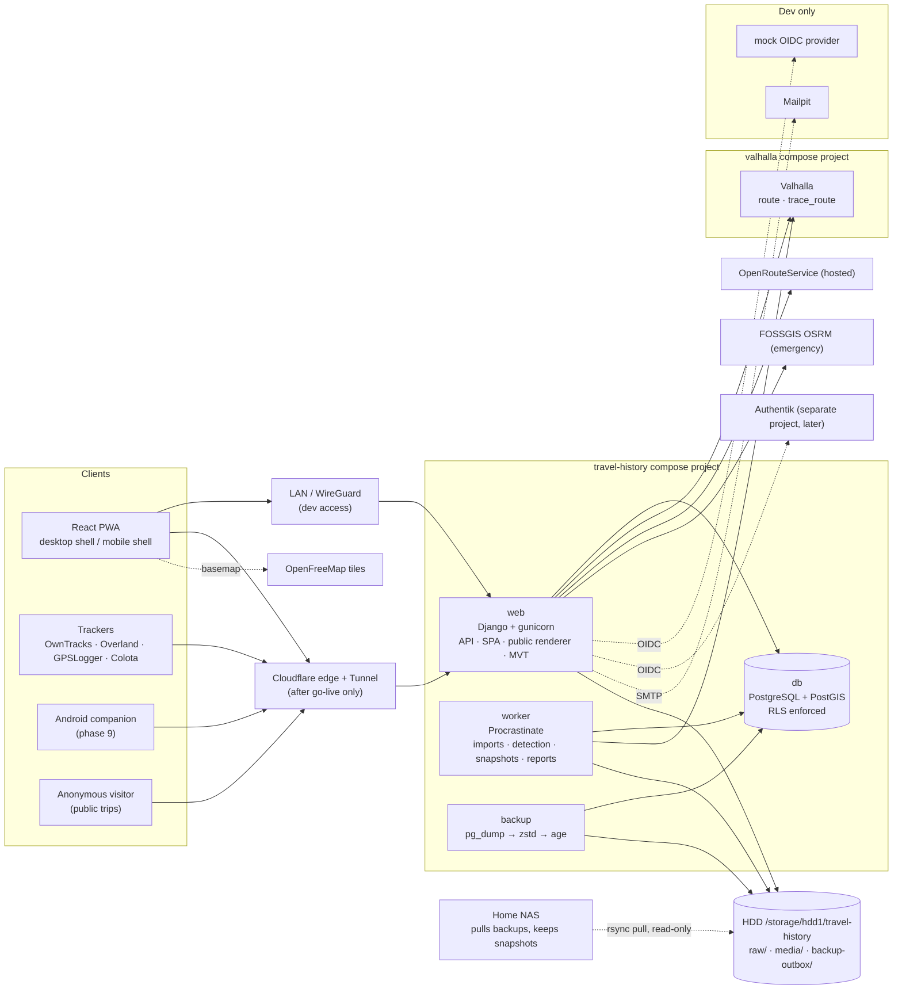

# Architecture

Moved from PLAN.md §3 on 2026-11-10. Section numbers (§N.M) are kept so references
like "PLAN.md §N" still resolve; the section map in PLAN.md says which file holds each §.

## 3. Architecture

Key points:

- **One image, three roles.** `web`, `worker` and the one-shot `migrate` job run the same backend
  image. The production SPA is built in a Node stage of the same Dockerfile and served by
  Django (WhiteNoise) from the same origin, so session cookies and CSRF work without CORS.
- **Two DB roles at runtime, one for migrations.** `travel_owner` owns the schema and only runs
  migrations. `web` and `worker` connect as `travel_app`, which is subject to row-level security.
  The public renderer connects as `travel_public`, which can read only the public snapshot tables
  (§6.5).
- **No Redis.** The job queue (Procrastinate), rate-limit counters and cache all live in
  PostgreSQL.
- **Networks.** `db` is only on an `internal: true` network with no published ports. `web` and
  `worker` join that network, a default egress network (ORS, SMTP, dataset downloads, Web Push)
  and the external `valhalla` network.
- **Storage.** PostgreSQL data in a named volume on the SSD. Raw import files, photo derivatives
  and the backup outbox on the HDD under `/storage/hdd1/travel-history` (bind-mounted as `/bulk`).
- **Containers run as non-root** (`user: ${APP_UID}:${APP_GID}`, matching the other apps so
  bind-mounted files stay owned by the host user), `cap_drop: [ALL]`, `no-new-privileges`,
  memory limits, and log rotation.
- **Valhalla** is its own compose project (`name: valhalla`, directory `valhalla/` in this repo
  for now) on an external Docker network `valhalla`, so the planned gas-price app can share it.
  Recommendation: move it to its own repo when the second consumer arrives.
