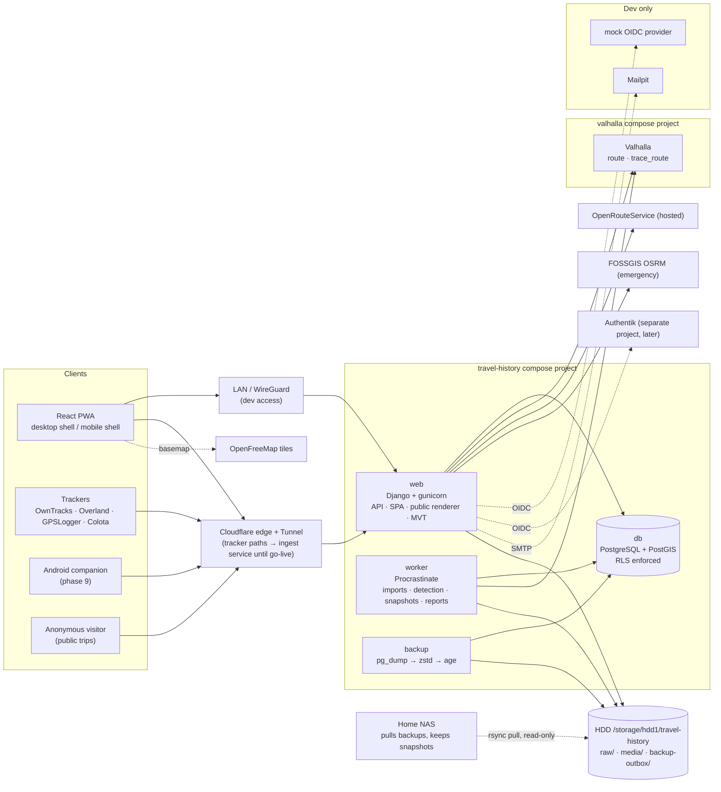

# Architecture

Moved from PLAN.md §3 on 2026-11-10. Section numbers (§N.M) are kept so references
like "PLAN.md §N" still resolve; the section map in PLAN.md says which file holds each §.

## 3. Architecture

Key points:

- **Two stacks, one set of service definitions (D-96).** `compose.yaml` holds the services;
  `compose.dev.yaml` turns them into the development stack (project `travel-history`: source
  mounts, runserver, mock OIDC, Mailpit, Vite, `127.0.0.1:8780` + LAN) and `compose.prod.yaml`
  into the production stack (project `travel-history-prod`: its own DB volume, networks and
  `.env.prod`, images built from a `git archive` of pushed `main` and tagged by commit, gunicorn
  on `127.0.0.1:8784`, the tracker-only `ingest` on `127.0.0.1:8783`). No development command can
  reach the production database ([production guide](../production.md)). Parallel build lanes
  (D-98) are git worktrees whose dev stacks are their own projects (`travel-history-lane-<item>`,
  own DB volume, ports 8800+/5180+, `var/bulk` in the worktree), never the real dev data
  ([development guide](../development.md)).
- **One image, three roles.** `web`, `worker` and the one-shot `migrate` job run the same backend
  image. The production SPA is built in a Node stage of the same Dockerfile and served by
  Django (WhiteNoise) from the same origin, so session cookies and CSRF work without CORS.
- **Two DB roles at runtime, one for migrations.** `travel_owner` owns the schema and only runs
  migrations. `web` and `worker` connect as `travel_app`, which is subject to row-level security.
  The public renderer connects as `travel_public`, which can read only the public snapshot tables
  (§6.5).
  Periodic jobs that cover every user (nightly maintenance, later coverage, detection and
  snapshots) still run as `travel_app`: they list the users through a narrow id-only function
  and then act as each user in turn, one transaction per user (§6.4, D-87).
- **No Redis.** The job queue (Procrastinate), rate-limit counters and cache all live in
  PostgreSQL.
- **Networks.** `db` is only on an `internal: true` network with no published ports. `web` and
  `worker` join that network, a default egress network (ORS, SMTP, dataset downloads, Web Push)
  and the external `valhalla` network.
- **Storage.** PostgreSQL data in a named volume per stack on the SSD. Raw import files, photo
  derivatives and the backup outbox under each stack's bulk directory, bind-mounted as `/bulk`:
  the HDD's `/storage/hdd1/travel-history` by design; until the replacement disk is mounted,
  `var/bulk` (dev, D-84) and `~/apps/travel-history-prod/bulk` (production) on the SSD.
- **Containers run as non-root** (`user: ${APP_UID}:${APP_GID}`, matching the other apps so
  bind-mounted files stay owned by the host user), `cap_drop: [ALL]`, `no-new-privileges`,
  memory limits, and log rotation.
- **Valhalla** is its own compose project (`name: valhalla`, directory `valhalla/` in this repo
  for now) on an external Docker network `valhalla`, so the planned gas-price app can share it.
  Recommendation: move it to its own repo when the second consumer arrives.
