# Data model

Moved from PLAN.md §5 on 2026-11-10. Section numbers (§N.M) are kept so references
like "PLAN.md §N" still resolve; the section map in PLAN.md says which file holds each §.

## 5. Data model

All user-owned rows carry an owner or author. All timestamps are `timestamptz` (UTC). Geometry
columns are `geometry(..., 4326)`; distance work casts to `geography`. Primary keys are `bigint`
identity except where noted. Names below are the PostgreSQL table names (Django app prefixes
omitted for readability: `trip` is `trips_trip`, etc.).

### 5.1 ERD

```mermaid
erDiagram
  USER |o--o| PERSON : "is (at most one)"
  PERSON ||--o{ HOME_PERIOD : has
  USER ||--o{ TRIP : owns
  TRIP ||--o{ LEG : "ordered legs"
  LEG ||--o{ ROUTE : "versions"
  LEG |o--o| ROUTE : "current_route"
  ROUTE ||--o{ ROUTE_SIMPLIFIED : "per zoom"
  TRIP ||--o{ TRIP_PARTICIPANT : ""
  PERSON ||--o{ TRIP_PARTICIPANT : ""
  LEG ||--o{ LEG_PARTICIPANT_OVERRIDE : "add/remove"
  PERSON ||--o{ LEG_PARTICIPANT_OVERRIDE : ""
  VEHICLE ||--o{ VEHICLE_OWNERSHIP : "ownership history"
  PERSON |o--o{ VEHICLE_OWNERSHIP : "owner (or outside owner)"
  VEHICLE ||--o| VEHICLE_PRIVATE : "plate, VIN"
  LEG }o--o| VEHICLE : uses
  LEG }o--o| AIRLINE : ""
  LEG }o--o| AIRPORT : "origin / destination"
  LEG }o--o| AIRCRAFT_TYPE : ""
  TRIP ||--o{ STOP : ""
  STOP }o--|| PLACE : at
  TRIP ||--o{ TRIP_NOTE : contributions
  TRIP ||--o{ MEDIA : contributions
  TRIP ||--o{ TRIP_TAG : ""
  TAG ||--o{ TRIP_TAG : ""
  TRIP ||--o{ TRACK_CONTRIBUTION : contributions
  USER ||--o{ IMPORT_BATCH : ""
  IMPORT_BATCH }o--|| RAW_FILE : "original bytes"
  IMPORT_BATCH ||--o{ LOCATION_POINT : ""
  IMPORT_BATCH ||--o{ TIMELINE_SEGMENT : ""
  USER ||--o{ LOCATION_POINT : "append-only"
  USER ||--o{ DEVICE_TOKEN : ""
  DEVICE_TOKEN ||--o{ LOCATION_POINT : ""
  TRIP ||--o{ REVIEW_FLAG : ""
  TRIP |o--o| PUBLIC_TRIP_SNAPSHOT : "if public"
  USER |o--o| PUBLIC_PROFILE : ""
  USER ||--o{ TRANSFER_OFFER : ""
```

### 5.2 People, users, preferences

| Table | Columns (type, notes) |
|---|---|
| `user` (custom `AbstractBaseUser`) | `email` citext unique · `display_name` · `role` enum(admin, member, viewer) · `oidc_issuer`, `oidc_sub` (unique together) · `person_id` → person, unique, nullable (a login links to at most one person) · `is_active` · `privacy_notice_ack_at` (the honesty notice, §6.7) · `onboarding_done_at` · `created_at`, `last_login` |
| `person` | `display_name` · `birth_year` null · `created_by` → user · `visibility` enum(family, private) default family · `notes` · `created_at`. A person is anyone who travels; most will never log in. The *managing user* of a person is its linked user if one exists, otherwise `created_by`. |
| `user_preference` | `user` · `key` · `device_class` enum(desktop, mobile, any) · `value` jsonb · unique(user, key, device_class). Holds split-pane ratio per device class, shell override, purpose→visibility defaults, detection thresholds, photo limit, privacy-zone radius. The frontend caches these in `localStorage`. |
| `purpose` | `owner` → user · `name` · `default_visibility` · `sort` · `archived`. Seeded per user: Work (private), Vacation, Family visit, Outdoors/Camping, Event, Moving, Other (participants). |

### 5.3 Trips, legs, routes, participation

| Table | Columns |
|---|---|
| `trip` | `owner` → user · `title` · `purpose` → purpose · `start_date`, `end_date` · `date_precision` enum(exact, day, month, year, approximate) · `status` enum(candidate, confirmed) · `visibility` enum(private, participants, family, public) · `public_mode` enum(unlisted, listed) null (required iff public) · `public_slug` (22-char random, unguessable) · `public_description` · `public_show_times` bool false · `privacy_zone_enabled` bool true · `privacy_zone_radius_m` int default 1000 · `cover_media` → media null · `notes` (the owner's) · `photo_limit_per_contributor` int default 10 · `locked` bool (confirmed trips are locked against detection re-runs) · `needs_review` bool · `source` enum(manual, detected, flight_import, merged) · `detection_fingerprint` · `edited_in_app_at` · timestamps. Check: `end_date >= start_date`. |
| `leg` | `trip` · `sequence` (unique per trip, deferrable) · `mode` enum(drive, flight, train, bus, boat, walk, other) · `start_utc`, `start_tz` (IANA name), `end_utc`, `end_tz` · `time_precision` (same enum as dates; old legs may only know the day) · `origin_stop`, `destination_stop` → stop null · `origin_label`, `destination_label` · `vehicle` → vehicle null · `author` → user · `is_contribution` bool · `participant_scope` enum(trip, author) · `current_route` → route null · `distance_m` (cached from current route) · flight fields: `airline` → airline, `flight_number`, `origin_airport`, `destination_airport` → airport, `aircraft_type` → aircraft_type, `aircraft_registration`, `seat`, `cabin_class` enum(economy, premium_economy, business, first, other) · `source_segments` (array of timeline_segment ids) · `import_batch` → import_batch null · timestamps. IANA zones are validated against `zoneinfo`. |
| `route` | `leg` · `version` (unique per leg) · `geom` MultiLineString (one part normally; several for antimeridian-split arcs and unmatched GPS gaps) · `kind` enum(gps, map_matched, routed, hand_edited, great_circle) · `waypoints` jsonb (ordered control points: `{lon, lat, role: anchor\|via}`) · `engine` (valhalla, ors, osrm-fossgis, none) · `engine_version` · `engine_data_date` · `produced_at` · `created_by` · `source_time_range` tstzrange null (for gps/map-matched: which slice of raw points produced it) · `length_m`. **Immutable:** a trigger rejects every `UPDATE`. Editing a route inserts a new version and moves `leg.current_route`. |
| `route_simplified` | `route` · `zoom` smallint (buckets 3, 6, 9, 12) · `geom`. Built once, when the route version is inserted. |
| `trip_participant` | `trip` · `person` · `added_by` · `public_consent` bool false (§6.6) · unique(trip, person) |
| `leg_participant_override` | `leg` · `person` · `include` bool · `set_by` · unique(leg, person). Effective leg participants = base set + includes − excludes, where the base set is the trip's participants (`participant_scope = trip`) or just the author's person (`participant_scope = author`, used for a contributor's own leg such as a separate flight home). |
| `place` | `owner` · `name` · `point` · `address` · `google_place_id` · `geonames_id` · `country_code`, `admin1_code`, `county_geoid` (from local reverse geocoding) · `source` enum(manual, timeline, geocoded). Owner-scoped reusable location. |
| `stop` | `trip` · `leg` null · `place` · `kind` enum(lodging, destination, visit, waypoint) · `arrive_utc`, `depart_utc`, `tz` · `author` · `source_segment` → timeline_segment null |
| `tag` / `trip_tag` | `tag(owner, name citext unique per owner, color)`; `trip_tag(trip, tag, author)` unique(trip, tag). The owner's tags are the trip's main tags; other participants' tags are attributed and filterable by person. Vehicle and purpose are never tags. |
| `trip_note` | `trip` · `author` · `body` (markdown) · `public_consent` · timestamps |
| `track_contribution` | `trip` · `author` · `time_range` · `route` → route (kind gps, built from the author's own points) · `public_consent`. A participant attaching their own GPS track to a shared trip. |
| `review_flag` | `trip` · `reason` enum(source_changed, overlap, flight_unmatched, …) · `details` jsonb · `created_at` · `resolved_at`, `resolved_by` |
| `rejected_candidate` | `owner` · `fingerprint` · `time_range` · `rejected_at`. Rejected detections never resurface. |
| `transfer_offer` | `from_user` · `to_user` · `kind` enum(trip, vehicle, home_period) · `object_id` · `status` enum(pending, accepted, declined) · `batch` uuid · timestamps |

### 5.4 Vehicles

| Table | Columns |
|---|---|
| `vehicle` | `nickname` · `year` · `make` · `model` · `trim` · `color` · `photo` → media null · `created_by` · `hidden` bool (owner hides it from family) · `is_rental` bool (quick-add) · `merged_into` → vehicle null · timestamps |
| `vehicle_private` | `vehicle` (PK) · `plate` · `plate_last4` · `vin`. Separate table so RLS can restrict it to the vehicle's managing user; the duplicate check compares `plate_last4` inside a `SECURITY DEFINER` function without revealing it. |
| `vehicle_ownership` | `vehicle` · `owner_person` → person null · `outside_owner_name` null · `outside_owner_kind` enum(rental, friend, employer, dealer, other) null · `valid_from`, `valid_to` date null (open ends) · `created_by`. `CHECK (num_nonnulls(owner_person, outside_owner_name) = 1)`. `EXCLUDE USING gist (vehicle WITH =, daterange(valid_from, valid_to, '[)') WITH &&)` → never two owners at once. A deferred constraint trigger rejects gaps between consecutive periods → exactly one owner at any time. |

Managing user of a vehicle = the account of its *current* owner person if that person has one,
otherwise `created_by`. Edit rights: managing user, plus the Admin if the Admin can see it.

### 5.5 Raw history and imports

| Table | Columns |
|---|---|
| `raw_file` | `owner` · `original_name` · `content_type` · `size_bytes` · `sha256` (of the original bytes; unique per owner → identical re-uploads detected) · `storage_path` (relative to `/bulk/raw`) · `compression` (zstd) · `compressed_size` · `uploaded_via` enum(web, companion, api) · `uploaded_at`. Immutable (trigger). File on disk is mode 0440 and verified by decompress-and-hash after write. |
| `import_batch` | `owner` · `kind` enum(google_timeline, flights_template, myflightradar24, flighty, appintheair, tripit, jetlog, byair, gpx) · `raw_file` · `status` enum(queued, processing, done, failed) · `summary` jsonb · `error` · timestamps |
| `location_point` | `id` bigint · `owner` · `ts` · `geom` Point · `accuracy_m`, `altitude_m`, `speed_mps`, `course_deg`, `battery_pct` · `source` enum(owntracks, overland, gpslogger, colota, google_raw, google_path, gpx, other) · `device` → device_token null · `import_batch` null · `received_at` · `extra` jsonb. **Append-only** (trigger rejects `UPDATE`; `DELETE` only through the owner's explicit purge). Unique (owner, source, device, ts) → duplicates dropped with `ON CONFLICT DO NOTHING`. Indexes: btree (owner, ts), BRIN (ts), GiST (geom). Partition by year later if it passes ~50 M rows. |
| `timeline_segment` | `owner` · `lineage_id` uuid (stable across versions) · `version` · `is_current` · `superseded_by` → self · `kind` enum(visit, activity, path, memory) · `start_utc`, `end_utc`, `time_range` (generated tstzrange) · `utc_offset_min` · `place_id` (Google) · `semantic_type` · `activity_type` · `probability` · `geom` (Point for visits, LineString for activities and paths) · `distance_m` · `data` jsonb (the normalized segment) · `fingerprint` (sha256 of the normalized content) · `import_batch` · `edited_in_app` bool. Versions are append-only; only `is_current`/`superseded_by` may change (trigger whitelist). GiST (owner, time_range) via `btree_gist`. |
| `coverage_report` | `owner` · `day` · `source` · `points` · `hours_with_points` · `gap_hours` int[] · `computed_at` · unique(owner, day, source) |
| `detection_run` | `owner` · `params` jsonb · `summary` jsonb · timestamps |

Rule: trips reference time ranges of raw data (`leg.source_segments`, `route.source_time_range`,
`track_contribution.time_range`); they never copy points. Derived, simplified route geometry is
not a copy of raw points.

### 5.6 Home periods

`home_period`: `person` · `managed_by` → user · `point` null · `address` · `label` · `valid_from`,
`valid_to` date null · `from_precision`, `to_precision` · `kind` enum(home, long_stay) · `status`
enum(suggested, confirmed, rejected) · `overlap_allowed` bool (deliberately overlapping, e.g.
college plus parents' house) · `shared_with_family` bool false · `source` enum(manual, detected,
google_hint) · `evidence` jsonb.

### 5.7 Media

`media`: `trip` null · `leg` null · `stop` null · `vehicle` null · `author` · `source`
enum(local, immich) · `external_id` (Immich asset id) · `display_path`, `thumb_path` (HDD) ·
`width`, `height`, `bytes`, `sha256` · `captured_at`, `captured_tz` · `caption` ·
`public_selected` (the owner picked it for the public page) · `public_consent` (the author agrees)
· `created_at`. Follows the trip's visibility. Per-contributor-per-trip limit enforced in the app
and by a trigger.

### 5.8 Reference datasets (no RLS, read-only to the app role)

| Table | Source | Notes |
|---|---|---|
| `airport` | OurAirports `airports.csv` | all types including `closed`; `iata_code`, `icao_code`/`gps_code`, `keywords` |
| `airport_code_history` | manual + derived | `code`, `airport`, `valid_from`, `valid_to`: resolves reassigned/closed codes by flight date; manual override |
| `airline` | OpenFlights `airlines.dat` | keeps defunct (`active = N`) airlines |
| `aircraft_type` | OpenFlights `planes.dat` | name, IATA, ICAO |
| `country`, `region` | Natural Earth admin-0 / admin-1 (10m) | MultiPolygon, GiST |
| `us_county` | Census cartographic boundary file (500k) | GEOID, MultiPolygon |
| `geonames_place` | GeoNames `cities500` (+ admin codes) | names for stops via nearest-place lookup |
| `dataset_version` | — | source, URL, version/date, checksum, license, loaded_at |

### 5.9 Access, devices, integrations

| Table | Columns |
|---|---|
| `access_request` | `name` · `email` · `relationship` · `note` · `status` enum(pending, approved, rejected) · `ip_hash` · `turnstile_ok` · `invite` → invite null · `decided_by`, `decided_at` · `idp_user_id` |
| `allowlist_entry` | `email` · `role` · `created_by` · `note` |
| `invite` | `token_hash` · prefill `name`/`email`/`relationship` · `role` · `created_by` · `expires_at` · `used_at`, `used_by` |
| `device_token` | `user` · `name` · `kind` enum(owntracks, overland, gpslogger, colota, generic) · `token_prefix` (display only) · `token_hash` (sha256, unique) · `created_at` · `last_used_at` · `revoked_at` · `points_received` |
| `push_subscription` | `user` · `endpoint` · `p256dh` · `auth` · `user_agent` · `failures` · `last_success_at` |
| `public_profile` | `user` unique · `slug` · `enabled` false · `display_name` · `bio` · `avatar` → media null |
| `integration_setting` | `user` · `provider` (immich) · `base_url` · `credential_encrypted` (Fernet, key from env) · `enabled` · `status` · `last_checked_at` |
| `audit_log` | `actor` · `action` · `object_type`, `object_id` · `at` · `details` jsonb (admin actions, approvals, transfers, merges, permission-relevant changes) |
| `public_trip_snapshot`, `public_media_file`, `public_profile_snapshot` | Allowlisted, pre-rendered public data (§6.5). The only tables the `travel_public` role can read. |
